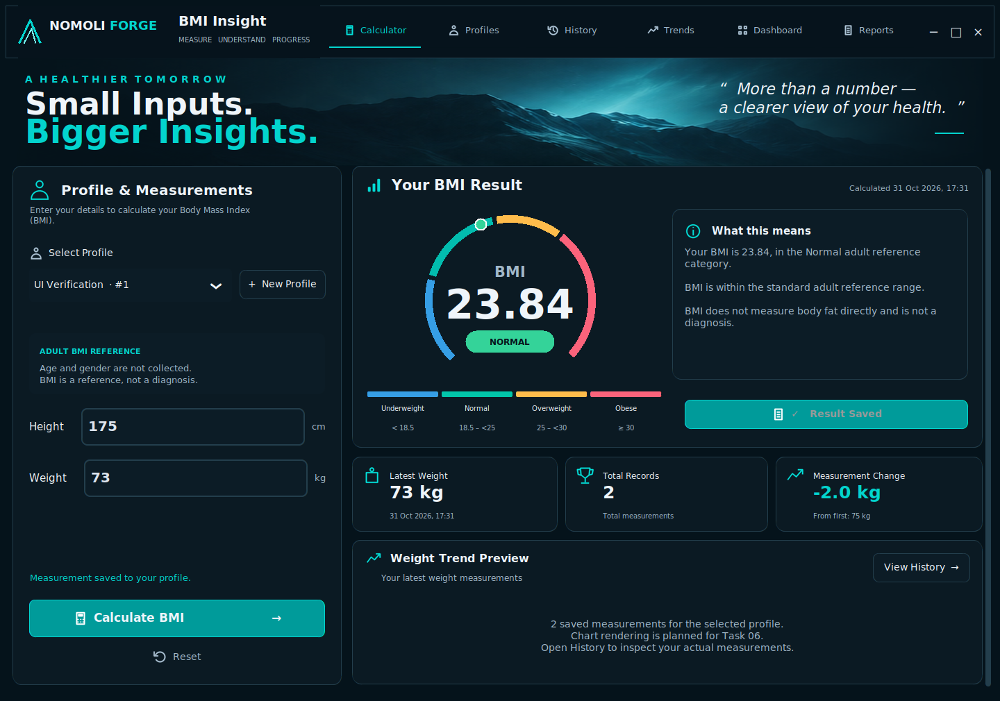

# NOMOLI FORGE — BMI Insight

An advanced Python desktop BMI calculator project for the Oasis Infobyte Python Programming internship. Tasks 03–05 implement the offline calculation core, SQLite persistence, application services and a CustomTkinter desktop UI based on the approved Mockup 05 — Vitality Analytics. Python 3.10+ is required; Python 3.12 with Tk 8.6 is the tested desktop configuration.

## Completed scope

- Unrounded BMI calculations, separate two-decimal formatting, and adult classification.
- Interactive measurement parsing with controlled `ValidationError` exceptions.
- Immutable results with derived BMI and category.
- Pure metric/imperial conversion utilities and automated pytest coverage.
- Desktop Calculator, Profiles and History views with a horizontal navigation bar.
- Live multicolour BMI gauge, classification metadata, summary cards and explicit saving.
- Local mountain-reference background, readable empty states and a reserved trend container.

SQLite profile and measurement persistence and the desktop GUI are implemented. Chart rendering, the Progress Dashboard and PDF reports remain planned; their navigation items show honest availability messages. No network calls are implemented. The core remains independent of storage and presentation.

## Desktop preview



[All six screenshots and visual review](docs/TASK05_REVIEW.md). To use the desktop application, follow the Windows launch instructions below.

## Formula and categories

BMI = weight in kilograms / (height in metres × height in metres).
Calculations use Python floating-point precision, without intentional rounding. Display formatting never changes the stored value or classification. Unrepresentable floating-point results raise ValidationError.

| Unrounded BMI | Category |
| --- | --- |
| Below 18.5 | Underweight |
| 18.5 to below 25 | Normal |
| 25 to below 30 | Overweight |
| 30 and above | Obese |

Zero, negative, non-finite and nonnumeric BMI values are rejected. These are the adult thresholds specified in the task. Category metadata provides a name, colour and neutral educational explanation, separately from classification.

## Structure

```text
Python-Task2-BMICalculator/
├── app/
│   ├── __init__.py
│   └── core/
│       ├── __init__.py
│       ├── calculator.py
│       ├── classification.py
│       ├── validator.py
│       ├── models.py
│       └── conversions.py
├── tests/
│   ├── test_calculator.py
│   ├── test_classification.py
│   └── test_validator.py
├── README.md
├── requirements.txt
├── pyproject.toml
└── .gitignore
```

Database and service packages sit alongside core under app. The desktop presentation package is app/ui; Matplotlib visualization remains planned. Dependencies belong in requirements.txt; pyproject.toml contains pytest configuration only.

## Installation and tests

From this project directory:

```bash
python -m venv .venv
# Windows:
.venv\Scripts\activate
# macOS/Linux:
source .venv/bin/activate
python -m pip install -r requirements.txt
python -m pytest -q
```

Only installing dependencies needs access to a package source; application use is offline. Task 03 verification: **139 passed, 0 failed, 0 skipped**. Tests include result-model and conversion tests in test_calculator.py.

## Usage and validation

```python
from app.core.calculator import calculate_bmi, create_result
from app.core.validator import ValidationError

raw_bmi = calculate_bmi(70, 1.75)  # approximately 22.857142857
try:
    result = create_result("70", "1.75")
    print(result.formatted_bmi, result.category.value)  # 22.86 Normal
except ValidationError as error:
    print(str(error))
```

The low-level calculator accepts built-in int/float values, excluding bool, and requires positive finite measurements. Interactive validators additionally accept numeric strings (including decimal and scientific notation), strip whitespace, and apply inclusive application support limits: **1–500 kg** and **0.30–2.75 metres**. These broad product limits catch likely unit mistakes and define the current supported input range. They are not medical thresholds and infer no health condition. Enter height in metres, e.g. 1.75 rather than 175. Unsupported types, blanks, NaN and infinity raise ValidationError, a ValueError subclass. Decimal and Fraction objects are deliberately unsupported; pass built-in numbers or interactive numeric text.

BMIResult is frozen and derives its BMI/category from validated measurements; callers cannot inject inconsistent derived fields. create_result is the convenient interactive entry point. The calculator itself has no UI or infrastructure dependencies.

## Conversions

International definitions: 1 pound = 0.45359237 kg; 1 inch = 0.0254 m; 1 cm = 0.01 m; 1 foot = 12 inches. Functions in conversions.py accept positive finite built-in numeric inputs, rejecting booleans and text. Feet/inches accepts whole nonnegative feet and inches from zero inclusive to 12 exclusive, requiring a positive total. Converted measurements should pass the metric validators before application use.

## Task 04: SQLite and local profiles

Profiles are local named collections, not authenticated user accounts. Names are trimmed, limited to 100 characters, reject control characters, and may repeat; integer IDs identify profiles. Listing uses ascending IDs. Renaming preserves IDs, creation times and history.

Storage uses Python sqlite3, short-lived connections, foreign keys enabled on every connection, explicit write transactions and rollback on errors. Queries use bound parameters. Schema version 1 is recorded with PRAGMA user_version; future versions are rejected until migration support is added. Initialization is idempotent; initialization does not migrate incompatible pre-existing custom tables.

| Table | Fields and constraints |
| --- | --- |
| profiles | id INTEGER PRIMARY KEY AUTOINCREMENT; name TEXT NOT NULL with trimmed length 1–100; created_at TEXT NOT NULL |
| bmi_records | id INTEGER PRIMARY KEY AUTOINCREMENT; profile_id INTEGER NOT NULL REFERENCES profiles(id) ON DELETE CASCADE; weight_kg REAL NOT NULL within 1–500; height_m REAL NOT NULL within 0.3–2.75; bmi_value REAL NOT NULL positive and at most 6000; category TEXT NOT NULL restricted to the four categories; measured_at TEXT NOT NULL |

Index: `bmi_records(profile_id, measured_at)`. Numeric checks reject invalid types, NaN and infinities. The BMI storage ceiling of 6000 exceeds the maximum reachable from supported measurements (approximately 5555.56); it is a representability guard, not a medical threshold. Repositories check result consistency using the Task 03 API. Application-managed writes normalize timestamps; arbitrary direct SQL is not an application API.

Timestamps are canonical ISO 8601 UTC strings, including six fractional digits and +00:00. Backdated aware datetimes are supported, naive datetimes are rejected. Chronological ordering uses `(measured_at, id)`; IDs break timestamp ties. Recent-N queries select the newest N and return that subset ascending. Latest/previous refer to measurement time, not insertion time.

Deleting a profile permanently cascades to all its measurements. `deletion_preview` returns the profile and record count for a future confirmation dialog; the preview is advisory and may change. Service deletion requires `confirmed=True`. Record get/delete always require both profile ID and record ID, preventing cross-profile lookups.

### Storage paths and privacy

- Override: set `BMI_INSIGHT_DATA_DIR` to the desired writable directory.
- Windows: `%LOCALAPPDATA%/NOMOLI_FORGE/BMI_Insight/bmi_insight.sqlite3` (home AppData/Local fallback).
- macOS: `~/Library/Application Support/NOMOLI_FORGE/BMI_Insight/bmi_insight.sqlite3`.
- Linux: `$XDG_DATA_HOME/nomoli-forge/bmi-insight/bmi_insight.sqlite3` (defaults to ~/.local/share).

Missing directories are created; inaccessible locations raise a controlled error. Explicit file paths and connection factories support tests. All database tests use temporary files; no tests access the real application database. Standalone `:memory:` is rejected because connections are short-lived; use a temporary file instead. SQLite files and sidecars are ignored by Git.

Records stay on the local device with no transmission, telemetry or logging of personal values. SQLite is not encrypted: anyone with filesystem access may read it. Profile selection is organizational isolation, not a security boundary. Protect the application-data directory and backups using operating-system access controls.

### Service API and example

```python
from app.database.connection import Database
from app.database.profile_repository import ProfileRepository
from app.database.measurement_repository import MeasurementRepository
from app.services.profile_service import ProfileService
from app.services.measurement_service import MeasurementService
from app.services.history_service import HistoryService

database = Database()  # Creates local storage only when explicitly called.
records = MeasurementRepository(database)
profiles = ProfileService(ProfileRepository(database), records)
measurements = MeasurementService(records)
history = HistoryService(records)
profile = profiles.create("Local profile")
saved = measurements.save(profile.id, "70", "1.75")
print(saved.formatted_bmi, saved.category.value)
```

| Service | Public operations |
| --- | --- |
| ProfileService | create(name), list(), get(id), select(id), rename(id, name), deletion_preview(id), delete(id, confirmed=True) |
| MeasurementService | save(profile_id, weight_kg, height_m, measured_at=None) → Measurement |
| HistoryService | history(profile_id, limit=None), latest(id), previous(id), comparison(id), chart_data(id), count(id), get(profile_id, record_id), delete(profile_id, record_id) |

No service accepts caller-supplied BMI/category for raw measurement saving. BMI is recalculated by Task 03 and saved without display rounding. Frozen Profile, Measurement, MeasurementComparison and DeletionPreview models contain only values. Comparison returns signed weight and BMI differences, with no medical interpretation. Empty latest/previous/comparison returns None; invalid IDs and missing profiles produce controlled exceptions. A missing record within the selected profile raises MeasurementNotFound.

Errors: Task 03 ValidationError handles inputs; DatabaseError covers storage failures, with InitializationError, IntegrityError, ProfileNotFound and MeasurementNotFound subclasses. User-readable messages do not contain SQL details; exceptions retain causes for debugging. Future UI should show str(error), not a raw traceback. No failures are silently swallowed.

### Added structure

```text
app/database/
  __init__.py  connection.py  schema.py  errors.py  validation.py
  models.py  profile_repository.py  measurement_repository.py
app/services/
  __init__.py  profile_service.py  measurement_service.py  history_service.py
main.py
tests/
  conftest.py  test_database.py  test_profile_repository.py
  test_measurement_repository.py  test_profile_service.py
  test_measurement_service.py
```

`python main.py` now launches the desktop interface and initializes storage. CustomTkinter and Pillow are desktop dependencies; Task 03–04 remain unchanged. Task 04 verification: **212 passed, 0 failed, 0 skipped**, including the unchanged 139 Task 03 cases.

## Task 05: Desktop application

The interface follows the selected image: horizontal top navigation, navy cards, turquoise highlights, mountain hero, left measurement panel, right gauge and interpretation, three summary cards and the lower Weight Trend Preview container. The image was used as a concrete layout reference. See [visual verification](docs/TASK05_REVIEW.md) for screenshots and differences.

### Windows launch

Use the standard Python 3.12 Windows installer with Tcl/Tk and pip enabled. Open Command Prompt in Python-Task2-BMICalculator:

```bat
py -3.12 -m venv .venv
.venv\Scripts\python.exe -m pip install -r requirements.txt
.venv\Scripts\python.exe main.py
```

After setup, run_windows.bat uses .venv automatically. It otherwise tries the Windows Python launcher (py -3). If batch files are blocked by local security settings, use the direct Python command above. Do not disable operating-system protections.

On macOS/Linux, activate your virtual environment, install requirements.txt, ensure Tk support is installed, and run `python main.py`. A graphical desktop is required. Tested desktop environment: Python 3.12.3, Tk 8.6.14, CustomTkinter 6.0.0 and Pillow. The cloud runtime's separate Tk 9 build produced poor font rendering; use Tk 8.6 for the verified appearance. A Windows desktop launch still needs local verification.

### Workflow

1. Create a local profile with New Profile, or choose one from the dropdown. Duplicate names show their unique IDs. Profiles supports select, rename and confirmed deletion.
2. Enter height in **centimetres** and weight in **kilograms**. Height is converted to metres with the existing utility before Task 03 validation. Supported ranges remain 30–275 cm and 1–500 kg.
3. Calculate BMI. The gauge, category, neutral explanation and calculation timestamp update from the unrounded result. Calculation alone does not save anything.
4. Save Result to Profile persists through the Task 04 service. The button is disabled without a profile/result, after saving, or when inputs change. Editing fields or selecting another profile clears stale results. Reset clears inputs and results, preserving stored history.
5. History retrieves the selected profile's records and supports confirmed deletion of one record. Empty profiles show an empty state. Selecting a profile never imports another profile's measurements.

Age and gender are omitted because the existing profiles do not support those fields. They are neither collected nor inferred. Classification remains the standard adult reference; the interface makes no age/gender-based medical interpretation.

Latest Weight and Total Records use SQLite data. Measurement Change compares the newest measurement to the **first measurement**, matching the reference label; it stays empty until two records exist. It is a signed arithmetic difference, not a health judgment. The underlying Task 04 comparison service still provides latest-versus-previous when needed.

Gauge rendering is a display mapping over BMI 12–40; the marker saturates outside that range while the number and classification remain accurate. Text formatting never changes stored precision. Trend integration uses `UIController.trend_points()` backed by HistoryService.chart_data; the card has no invented line or data points. Trends, Dashboard and Reports navigation currently opens a clearly labelled planned-feature view.

The main content scrolls in shorter windows; the top navigation and hero remain fixed. Minimum logical window size is 1240×860; the preferred visual review size is 1440×1010. Operating-system scaling may change the physical screen space needed. Native title-bar controls are preserved; the in-app right-hand controls also minimize, maximize and close the window.

### Tests

```bat
.venv\Scripts\python.exe -m pytest -q
```

**Task 05 final verification: 240 passed, 0 failed, 0 skipped**, including 212 unchanged backend tests and 28 new controller/desktop tests. Desktop tests ran with a real Tk 8.6 GUI on a temporary Xvfb display. Without a graphical display, desktop tests explicitly skip (rather than pretending to run); controller and backend tests still run. Every database test uses isolated temporary SQLite files. No test or screenshot populates the real user database.

## Planned work and limitations

Full Matplotlib chart rendering belongs to Task 06. Progress Dashboard and PDF reports remain later work. There is no AI, cloud synchronization, authentication, backup/restore UI or general migration system. SQLite remains unencrypted local storage. Profile isolation is organizational, not an account security boundary.

The standalone high-resolution mountain asset and official vector logo were unavailable: the supplied image's clean mountain region is used locally, and line-based branding/icons are reconstructed. Typography falls back from Segoe UI to the platform font. Buttons use solid turquoise rather than the reference's luminous gradients; cards have simpler lighting and the gauge has no diffuse glow. These are documented differences, not claims of pixel-perfect reproduction.

Task 05 stops at this implementation and review package. No Task 06 work, commit or push is performed automatically.

## Educational limitations

BMI is a screening reference, not a diagnosis or a direct measurement of body fat. It does not distinguish muscle from fat or describe individual health. Adult categories are not appropriate for assessing children; pregnancy and individual circumstances also require professional interpretation. This software provides educational calculations, not medical advice.
