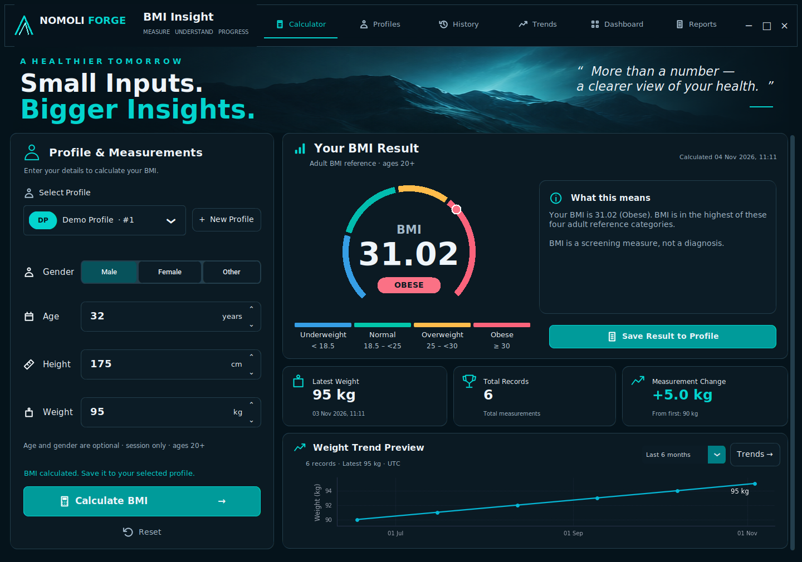
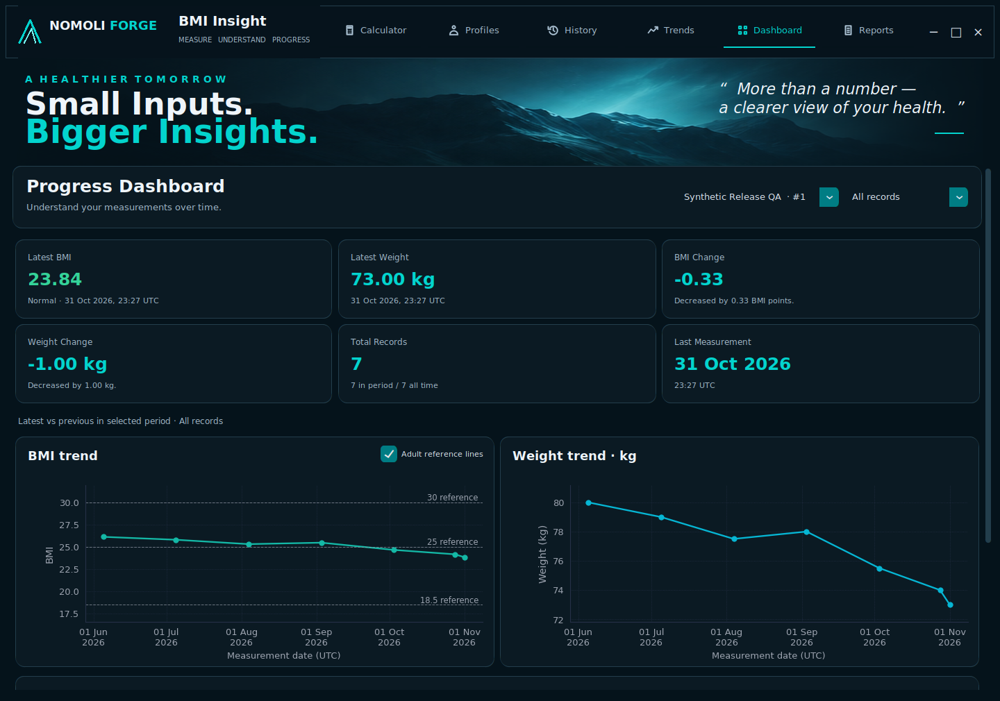
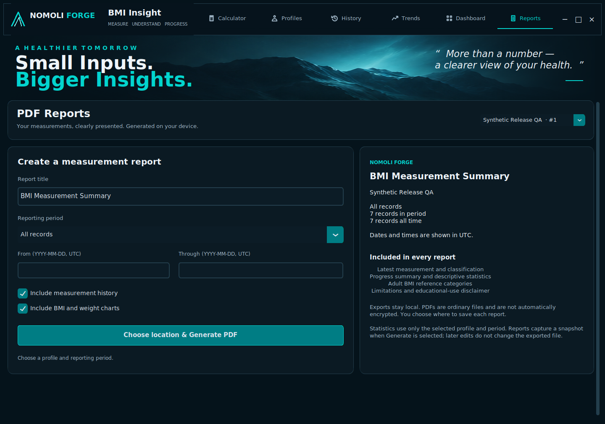

# NOMOLI FORGE — BMI Insight

**Oasis Infobyte Python Programming internship · Official Task 2: Advanced BMI Calculator**

BMI Insight is a local Python desktop application for calculating adult BMI, managing named profiles, reviewing measurement history and exporting PDF summaries. Its CustomTkinter interface follows the approved **Mockup 05 — Vitality Analytics**: horizontal navigation, dark navy cards, teal accents, a mountain hero and circular BMI gauge.

**Release status: conditionally ready, pending manual Windows verification.** Task 08 audits and fixes are prepared for review; no executable or published release is claimed. See [release-readiness report](docs/RELEASE_READINESS.md), [Windows verification checklist](docs/WINDOWS_VERIFICATION.md) and [internship demonstration guide](docs/SUBMISSION.md).

## Features

- Full-precision BMI calculation with separate two-decimal display and four adult categories.
- Input validation, meaningful error messages and tested metric/imperial conversion utilities.
- Multiple local profiles, rename/select and confirmed deletion.
- SQLite measurement history, deterministic chronological ordering and profile isolation.
- Calculator with a live BMI gauge, category explanation, explicit Save action and weight preview.
- Embedded BMI/weight charts, selectable periods, adult reference lines and descriptive statistics.
- Progress Dashboard with latest values, neutral changes, period/all-time counts and recent records.
- Locally generated A4 PDF reports with optional history/charts, custom dates, pagination and disclaimers.
- Offline operation after dependencies are installed; no telemetry, login, cloud sync or API calls.

The desktop accepts **centimetres and kilograms**. Imperial conversion functions exist in the core; a GUI unit switch is not implemented. Age and gender are optional Calculator fields. Both clear on reset or profile change and are never saved or included in reports. Neither changes the BMI formula or category. Adult classifications are intended for **ages 20 and older**, not children or adolescents. BMI is a screening reference, not a diagnosis.

## Screenshots

These are genuine **Linux / Python 3.12 / Tk 8.6** captures using synthetic verification profiles. They are not Windows screenshots. The application starts without this demo data.



[Compact Calculator at 1240 × 860](docs/screenshots/calculator-refinement/BMI_Insight_Calculator_Compact.png)





Additional captures: [Profiles](docs/screenshots/task08/profiles.png), [History](docs/screenshots/task08/history.png), [Trends](docs/screenshots/task08/trends.png), [Dashboard insights](docs/screenshots/task08/dashboard_scrolled.png), [PDF summary](docs/screenshots/task08/pdf_summary.png), [PDF charts](docs/screenshots/task08/pdf_charts.png).

The decorative mountain is a crop from the supplied mockup; the separate original high-resolution artwork and vector branding were not supplied. [Asset provenance](assets/README.md) documents the source and locally drawn icons. The design is preserved, with practical desktop controls, scrolling and educational wording.

## Requirements and technology

Use **Python 3.12 with Tcl/Tk 8.6** for the verified configuration. Application syntax and declared dependencies support Python 3.10+, but only Python 3.12.3 was executed for this audit. A graphical desktop is required. Default window: 1440×1010; minimum logical size: 1240×860, with scrollable main content. Higher display scaling requires more physical pixels.

| Component | Purpose | Declared dependency |
| --- | --- | --- |
| Python / sqlite3 / tkinter | Core, local storage, desktop integration | Standard Python libraries; install Tcl/Tk |
| CustomTkinter | Desktop widgets | 6.0.0 |
| Pillow | Local artwork/icons | >=10.4,<13 |
| Matplotlib | Embedded charts and PDF chart images | >=3.10,<3.11 |
| ReportLab | Local PDF rendering | >=4.4,<5 |
| pytest | Automated tests | >=8,<10 |
| pypdf | PDF verification in tests | >=6,<7 |

Dependencies are declared once in `requirements.txt`. `pyproject.toml` only configures pytest. No dependencies were added during Task 08. Installing packages requires internet or a compatible local wheel source; calculations, storage, charts and export work offline afterward.

## Windows installation and launch

Install Python 3.12 from its standard Windows installer with pip and Tcl/Tk enabled. Open PowerShell in `OIBSIP\Python-Task2-BMICalculator`.

```powershell
py -3.12 -m venv .venv
.\.venv\Scripts\python.exe -m pip install -r requirements.txt
.\.venv\Scripts\python.exe main.py
```

If `.venv` already exists, skip its creation and run the install/update command. Activation is not required. After installation, launch with the final command or `run_windows.bat`; the batch file uses the local environment when present and otherwise uses `py -3`.

If Windows blocks a batch file, use the direct Python command. Do not disable Smart App Control, antivirus or other protections. If dependencies cannot download, retry installation when connectivity is available. The application does not need internet once installation succeeds.

On Linux/macOS, create/activate a virtual environment, install `requirements.txt`, ensure tkinter is installed, and run `python main.py`. Linux distributions may package Tcl/Tk separately. Tk 8.6 is the verified visual target; the cloud's separate Tk 9 build previously rendered fonts differently.

**Windows has not yet been manually verified.** Complete [this checklist](docs/WINDOWS_VERIFICATION.md), including native save/overwrite dialogs, DPI scaling and the spawned PDF worker.

## Using BMI Insight

### Profiles and calculation

1. Use **New Profile**, or open **Profiles** to create/select a named collection. Names are trimmed, limited to 100 characters and reject control/format/line-separator characters. Duplicate names are distinguished by internal IDs. Profiles are not authenticated accounts.
2. Enter height in **cm** and weight in **kg**. Press **Calculate BMI**, or Enter while a measurement input has focus.
3. Review the gauge, category and neutral explanation. Calculation alone does not save anything.
4. Click **Save Result to Profile**. Saving requires a selected profile and calculated result; repeated saving is disabled until recalculation. Input edits and profile switches invalidate the unsaved result. Reset clears inputs/results without deleting history.
5. Rename profiles from **Profiles**. Deleting a profile requires confirmation and permanently removes all its measurements through SQLite cascading deletion.

### History and charts

**History** shows records for the selected profile and supports confirmed record deletion. It displays local time. **Trends** and chart axes use UTC. Chronological ordering uses measurement timestamp, then record ID; equal-time records are kept, though markers can overlap.

Trends offers BMI and weight charts, optional adult BMI reference lines, latest/previous measurements, signed changes versus previous/first, minimum/maximum/average BMI and record counts. The Calculator preview shows actual saved weights; its summary cards retain **all-time** latest/count/change-versus-first semantics.

Period rules:

- **Last 30 days:** rolling 30×24 hours.
- **Last 3/6/12 months:** calendar-month subtraction, clamped to a valid day at month ends.
- Rolling filters use inclusive UTC bounds ending at the current instant; future-dated entries are excluded.
- **All records:** all saved records, including future-dated entries if present.
- Reports additionally offer inclusive **Custom dates**, from the beginning of the start UTC date through the end of the final UTC date.

Empty histories and filters show explanatory states. One record produces a single marker, without claiming a trend. No averaging, synthetic points or downsampling changes the saved records. Marker size decreases for large histories; figures are reused and cleared on close.

### Progress Dashboard

Open **Dashboard** to select a profile and period. Six cards show latest BMI/category/date, latest weight/date, BMI change, weight change, record counts and last measurement. Changes compare the latest two measurements **inside the selected period**. Counts distinguish the filtered period from all time.

Scroll below the charts for minimum/maximum/average BMI, first/latest dates and the four most recent selected-period records. Empty profiles show **No measurements recorded yet.** and an **Open Calculator** action. Increases/decreases are arithmetic descriptions, not judgments about health.

Save/delete/profile actions refresh charts and summaries, including existing hidden views. Navigating back reloads relevant data. There is no background watcher for changes made by external programs.

### PDF reports

1. Open **Reports** and select a profile.
2. Keep **BMI Measurement Summary** or enter a title of 1–100 characters.
3. Select a period. For Custom dates, enter both dates as `YYYY-MM-DD`; start must not follow end.
4. Choose whether to include history and BMI/weight charts.
5. Click **Choose location & Generate PDF**, choose a filename/folder and confirm any replacement in the native save dialog. Cancelling saves nothing.
6. Wait for the success message naming the captured profile and destination. Other pages remain usable; normal application closure waits for the active export to finish.

Reports use white A4 pages with navy/teal accents, embedded fonts, page numbers and repeated history headers. They include the selected profile/period, latest measurement, adult classification, progress versus the first measurement in the period, descriptive statistics and educational limitations. Optional charts contain real saved data. Fewer than two measurements produces an explanation instead of a trend chart. Empty profiles can generate an informative report.

Reports capture an immutable snapshot when Generate is selected. Later profile/measurement edits do not change that export; completion feedback names the original profile. A separate spawned process isolates Matplotlib rendering from Tk. Chart images stay in memory. The PDF is staged beside its destination and published only after rendering succeeds; normal failures clean up staging files and preserve any existing output. Safe suggested names avoid Windows reserved characters. Programmatic export refuses overwrite unless explicitly authorized.

PDFs are ordinary **unencrypted files**. They are not automatically saved to the repository or uploaded. Choose their destination and sharing recipients deliberately. Unsupported PDF-font characters produce a controlled error; full CJK/emoji/complex-script typography is not supported.

## Calculation and classification

`BMI = weight_kg / (height_m × height_m)`.

The implementation uses successive divisions to avoid height-squared underflow for extreme numeric inputs. Python floating-point precision is retained; only presentation rounds to two decimals. Classification uses the original value, even when display rounding reaches a category boundary.

| Unrounded BMI | Adult category |
| --- | --- |
| Below 18.5 | Underweight |
| 18.5 to below 25 | Normal |
| 25 to below 30 | Overweight |
| 30 or above | Obese |

The low-level calculator accepts positive finite built-in integers/floats, excluding booleans. Interactive validation also parses numeric strings. Empty, invalid, zero, negative, NaN and infinite inputs raise `ValidationError`. Inclusive **application support limits** are 1–500 kg and 0.30–2.75 m (30–275 cm in the GUI). These catch likely unit mistakes; they are not health thresholds. Unsupported Decimal/Fraction objects must be converted to supported inputs by the caller.

Conversion constants: 1 lb = 0.45359237 kg; 1 inch = 0.0254 m; 1 cm = 0.01 m; 1 foot = 12 inches. Feet must be a whole nonnegative number, inches must be in [0,12), and total height must be positive and representable. Conversions are tested independently.

```python
from app.core.calculator import create_result
result = create_result("70", "1.75")  # Core APIs use metres, not GUI centimetres.
print(result.formatted_bmi, result.category.value)  # 22.86 Normal
```

The gauge maps BMI 12–40 visually and saturates its marker outside that interval. The displayed number and classification remain accurate. It is not a separate calculation engine.

## Architecture

```text
Python-Task2-BMICalculator/
├── app/
│   ├── core/           # Calculation, validation, categories, immutable result, conversions
│   ├── database/       # SQLite lifecycle, schema, repositories, controlled storage errors
│   ├── services/       # Profiles, measurements, history, analytics, Dashboard, reports
│   ├── visualization/  # Reusable BMI and weight Matplotlib renderers
│   ├── reports/        # Frozen options/snapshots, print styles, atomic PDF export
│   └── ui/             # Window/controller, six navigation views, chart lifecycle
├── assets/             # Local mountain crop; provenance documented
├── docs/               # Milestone reviews, release checklist and screenshots
├── tests/              # Core, repository, service, rendering and desktop tests
├── main.py
├── run_windows.bat
├── requirements.txt
├── pyproject.toml
└── .gitignore
```

The GUI calls services; services coordinate the core and repositories; repositories use SQLite. The core has no GUI/database dependencies. Chart and PDF renderers accept prepared values and execute no SQL. Models contain values rather than widgets/connections. Existing public APIs remain intact.

Key interfaces: `create_result(weight_kg, height_m)`, `ProfileService`, `MeasurementService.save`, profile-scoped `HistoryService.history/get/delete`, `AnalyticsService.snapshot`, `DashboardService.snapshot`, `ReportService.prepare`, and `generate_pdf(data, path, overwrite=False)`. Domain input errors use `ValidationError`, storage errors use the `DatabaseError` hierarchy, and export errors use `ReportError`. User-facing messages omit raw SQL and sensitive exception details.

## Storage and privacy

| Platform | Default database location |
| --- | --- |
| Windows | `%LOCALAPPDATA%\NOMOLI_FORGE\BMI_Insight\bmi_insight.sqlite3` (home AppData/Local fallback) |
| macOS | `~/Library/Application Support/NOMOLI_FORGE/BMI_Insight/bmi_insight.sqlite3` |
| Linux | `$XDG_DATA_HOME/nomoli-forge/bmi-insight/bmi_insight.sqlite3`, or `~/.local/share/nomoli-forge/bmi-insight/bmi_insight.sqlite3` |

`BMI_INSIGHT_DATA_DIR` overrides the directory. Missing parent directories are created; inaccessible storage raises a controlled error. Storage is outside the installed source by default. Tests inject temporary file paths and never use the real application database. Standalone `:memory:` is unsupported because repository connections are short-lived.

Schema version 1:

- `profiles`: auto-increment ID, nonempty name and UTC creation timestamp.
- `bmi_records`: auto-increment ID, profile foreign key with `ON DELETE CASCADE`, validated weight/height/BMI/category and UTC measurement timestamp.
- Index on `(profile_id, measured_at)`; timestamp/ID ordering breaks ties deterministically.
- Every connection enforces foreign keys. Writes use transactions with rollback and reliable closure. Queries use parameters. The sole interpolated schema PRAGMA uses an internal version constant, not user input.
- Measurement save recalculates BMI/category through the core. Callers cannot save arbitrary BMI values through the measurement service.

UTC timestamps use ISO 8601 with six fractional digits. Numeric database constraints supplement validation. No migrations for arbitrary incompatible databases or general backup UI are provided. Close the app before manually copying its database for backup; restoring/replacing data is not part of the automated tests.

No measurements are transmitted or logged by application code. **SQLite is not encrypted at rest.** Local profile separation is organizational isolation, not authentication or an access-control boundary against someone who can read the database. Protect database copies and PDFs using operating-system permissions. Databases, PDFs, secrets, caches, environments and build output are excluded by `.gitignore`.

## Testing and verified status

From the project folder:

```powershell
.\.venv\Scripts\python.exe -m pytest -q
```

The Calculator refinement adds two desktop regression tests. The suite now contains 350 tests.

Task 08 results: **348 collected; 348 passed; 0 failed; 0 skipped; 0 pytest warnings reported**. All 324 prior tests are preserved, with 24 release-audit cases added. Coverage percentage was not measured; no coverage tool was installed. A graphical session is required for desktop tests; they explicitly skip when no display is available.

Verified on Linux: Python 3.12.3, Tk 8.6.14, CustomTkinter 6.0.0, Pillow 12.3.0, Matplotlib 3.10.8, ReportLab 4.4.9 and pypdf 6.10.0. Real Tk tests used Xvfb and isolated temporary databases. The entry point was also launched with temporary application data and no stderr. Windows path selection is unit-tested by simulation; **this is not a Windows GUI test**.

The end-to-end test covers create/calculate/save, all navigation pages, real background PDF export, profile isolation, deletion/refresh and persistence after closing/reopening. Five PDF cases were generated and inspected: empty, single, several, all four categories, and 180 records with long names/title. Existing calculation boundaries, conversions, transactional rollback, cascading deletion, timestamp ties, filters and figure cleanup remain covered.

[Full audit results and fixes](docs/RELEASE_READINESS.md) distinguish automated checks from visual inspection and outstanding manual verification. Earlier milestone reports remain available under docs/TASK05_REVIEW.md, TASK06_REVIEW.md and TASK07_REVIEW.md as historical records.

## Known limitations and educational use

- Manual Windows launch, native dialogs, spawned PDF export and 100%/125%/150% DPI checks remain pending. The minimum logical window may exceed a small laptop's usable display at high scaling.
- No packaged executable, installer, auto-update, authentication, cloud service or AI recommendations are implemented. Packaging is optional for the source submission.
- No GUI imperial switch; optional age/gender stay in the form only. The adult 20+ scope is shown explicitly.
- Very large histories still require synchronous database reads and chart drawing. Export rendering is separate, one job at a time, without cancellation/progress percentage.
- OS/process termination may leave a `.bmi-report-*.tmp` file; ordinary export failures clean up. Non-overwriting atomic publication uses a filesystem hard link, so unsupported filesystems can produce a controlled export error; choose a supported local destination.
- PDF fonts do not cover every writing system. Long titles/names wrap and can add pages. PDFs are not tagged for full accessibility compliance.
- The original standalone mountain/vector assets were unavailable; see asset provenance. No independent artwork licence is asserted.

**Body Mass Index (BMI) is a screening measure, not a medical diagnosis. BMI does not directly measure body fat or account for all factors affecting an individual's health. This report is intended for general informational purposes.**

The implemented classification is intended for adults aged 20 and older. It does not distinguish muscle from fat or assess personal health. Children/adolescents, pregnancy and individual circumstances require different interpretation. This project offers educational calculations and descriptive records, not treatment plans or weight-loss prescriptions.

## Author and internship

**Hassan Barrie** · [barriehassan on GitHub](https://github.com/barriehassan) · **NOMOLI FORGE**.

Developed for the Oasis Infobyte Python Programming internship, Task 2 — Advanced BMI Calculator. Development milestones numbered 03–08 are internal project phases, not different internship task numbers. This repository is independent of Oasis Infobyte and does not imply endorsement. Third-party libraries retain their respective licences; installed distributions include their licence information. Explain and acknowledge assistance/dependencies according to the internship's submission rules.
