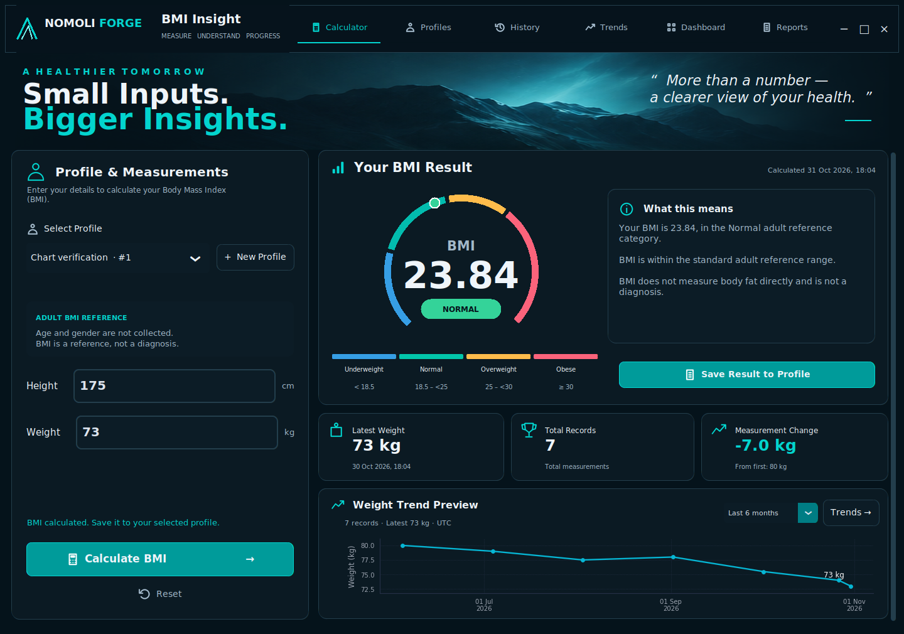
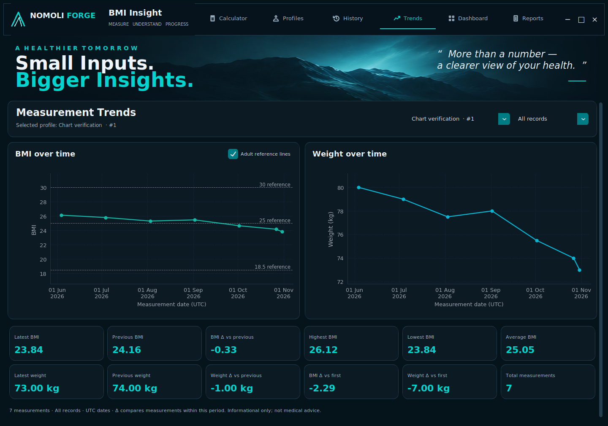
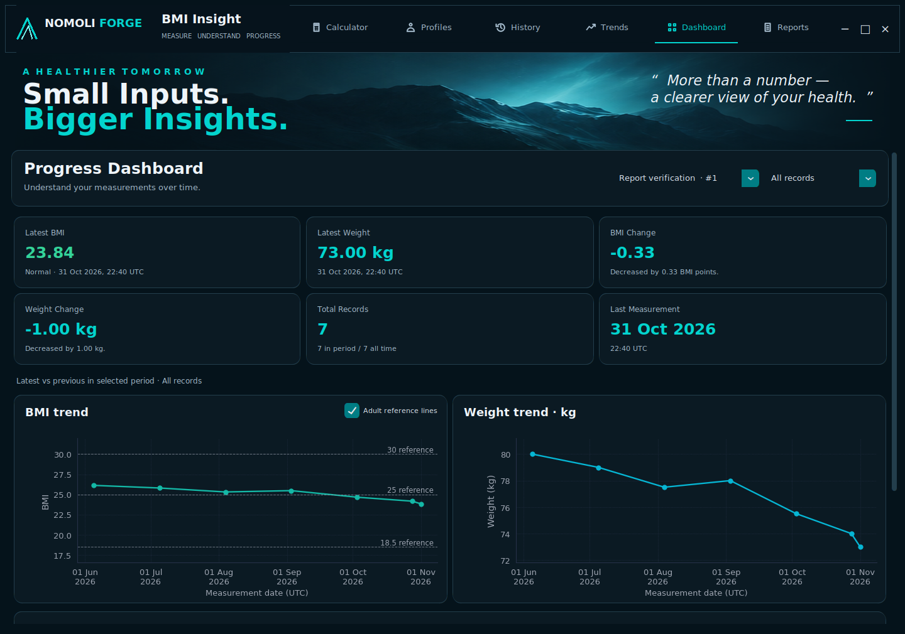
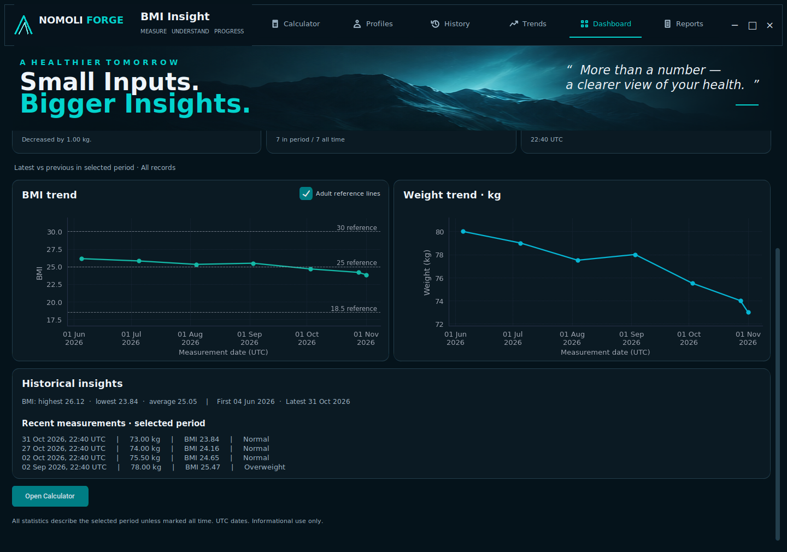
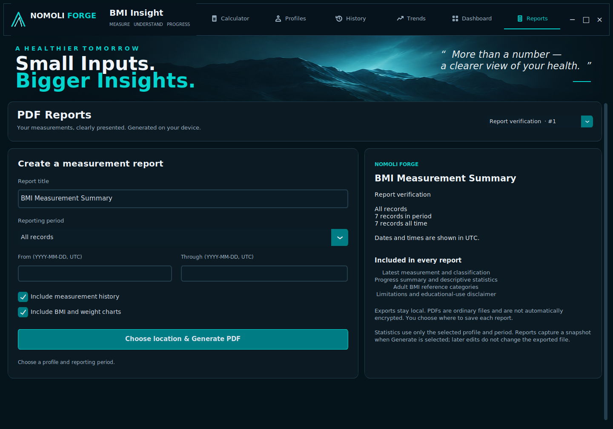

# NOMOLI FORGE — BMI Insight

An advanced Python desktop BMI calculator project for the Oasis Infobyte Python Programming internship. Tasks 03–07 implement the offline calculation core, SQLite persistence, application services and a CustomTkinter desktop UI based on the approved Mockup 05 — Vitality Analytics. Python 3.10+ is required; Python 3.12 with Tk 8.6 is the tested desktop configuration.

## Completed scope

- Unrounded BMI calculations, separate two-decimal formatting, and adult classification.
- Interactive measurement parsing with controlled `ValidationError` exceptions.
- Immutable results with derived BMI and category.
- Pure metric/imperial conversion utilities and automated pytest coverage.
- Desktop Calculator, Profiles and History views with a horizontal navigation bar.
- Live multicolour BMI gauge, classification metadata, summary cards and explicit saving.
- Local mountain-reference background and readable empty states.
- Embedded Matplotlib BMI/weight charts, date filters and full-precision historical statistics.
- Progress Dashboard with six summary cards, recent measurements and descriptive insights.
- Local ReportLab PDF exports with optional history/charts and custom date ranges.

SQLite profile and measurement persistence and the desktop GUI are implemented. BMI/weight chart rendering and the Trends page are implemented. Progress Dashboard and PDF reports are implemented. No network calls are implemented. The core remains independent of storage and presentation.

## Desktop preview





[Task 06 screenshots and verification](docs/TASK06_REVIEW.md). The [Task 05 visual review](docs/TASK05_REVIEW.md) remains as milestone history. To use the desktop application, follow the Windows launch instructions below.

## Formula and categories

BMI = weight in kilograms / (height in metres × height in metres).
Calculations use Python floating-point precision, without intentional rounding. Display formatting never changes the stored value or classification. Unrepresentable floating-point results raise ValidationError.

| Unrounded BMI | Category |
| --- | --- |
| Below 18.5 | Underweight |
| 18.5 to below 25 | Normal |
| 25 to below 30 | Overweight |
| 30 and above | Obese |

Zero, negative, non-finite and nonnumeric BMI values are rejected. These are the adult thresholds specified in the task. Category metadata provides a name, colour and neutral educational explanation, separately from classification.

## Structure

```text
Python-Task2-BMICalculator/
├── app/
│   ├── core/           # BMI, validation, categories and conversions
│   ├── database/       # SQLite connections, schema and repositories
│   ├── services/       # Profiles, measurements, history, analytics, dashboard, reports
│   ├── visualization/  # Shared Matplotlib renderers
│   ├── reports/        # Validated report models, print styles, atomic PDF renderer
│   └── ui/             # Calculator, Profiles, History, Trends, Dashboard, Reports
├── assets/
├── docs/               # Milestone reviews and screenshots
├── tests/
├── main.py
├── run_windows.bat
├── README.md
├── requirements.txt
├── pyproject.toml
└── .gitignore
```

Database and service packages sit alongside core under app. The desktop presentation package is app/ui; Matplotlib renderers are in app/visualization, with data preparation in app/services/analytics_service.py. Dependencies belong in requirements.txt; pyproject.toml contains pytest configuration only.

## Installation and tests

From this project directory:

```bash
python -m venv .venv
# Windows:
.venv\Scripts\activate
# macOS/Linux:
source .venv/bin/activate
python -m pip install -r requirements.txt
python -m pytest -q
```

Only installing dependencies needs access to a package source; application use is offline. Task 03 verification: **139 passed, 0 failed, 0 skipped**. Tests include result-model and conversion tests in test_calculator.py.

## Usage and validation

```python
from app.core.calculator import calculate_bmi, create_result
from app.core.validator import ValidationError

raw_bmi = calculate_bmi(70, 1.75)  # approximately 22.857142857
try:
    result = create_result("70", "1.75")
    print(result.formatted_bmi, result.category.value)  # 22.86 Normal
except ValidationError as error:
    print(str(error))
```

The low-level calculator accepts built-in int/float values, excluding bool, and requires positive finite measurements. Interactive validators additionally accept numeric strings (including decimal and scientific notation), strip whitespace, and apply inclusive application support limits: **1–500 kg** and **0.30–2.75 metres**. These broad product limits catch likely unit mistakes and define the current supported input range. They are not medical thresholds and infer no health condition. Enter height in metres, e.g. 1.75 rather than 175. Unsupported types, blanks, NaN and infinity raise ValidationError, a ValueError subclass. Decimal and Fraction objects are deliberately unsupported; pass built-in numbers or interactive numeric text.

BMIResult is frozen and derives its BMI/category from validated measurements; callers cannot inject inconsistent derived fields. create_result is the convenient interactive entry point. The calculator itself has no UI or infrastructure dependencies.

## Conversions

International definitions: 1 pound = 0.45359237 kg; 1 inch = 0.0254 m; 1 cm = 0.01 m; 1 foot = 12 inches. Functions in conversions.py accept positive finite built-in numeric inputs, rejecting booleans and text. Feet/inches accepts whole nonnegative feet and inches from zero inclusive to 12 exclusive, requiring a positive total. Converted measurements should pass the metric validators before application use.

## Task 04: SQLite and local profiles

Profiles are local named collections, not authenticated user accounts. Names are trimmed, limited to 100 characters, reject control characters, and may repeat; integer IDs identify profiles. Listing uses ascending IDs. Renaming preserves IDs, creation times and history.

Storage uses Python sqlite3, short-lived connections, foreign keys enabled on every connection, explicit write transactions and rollback on errors. Queries use bound parameters. Schema version 1 is recorded with PRAGMA user_version; future versions are rejected until migration support is added. Initialization is idempotent; initialization does not migrate incompatible pre-existing custom tables.

| Table | Fields and constraints |
| --- | --- |
| profiles | id INTEGER PRIMARY KEY AUTOINCREMENT; name TEXT NOT NULL with trimmed length 1–100; created_at TEXT NOT NULL |
| bmi_records | id INTEGER PRIMARY KEY AUTOINCREMENT; profile_id INTEGER NOT NULL REFERENCES profiles(id) ON DELETE CASCADE; weight_kg REAL NOT NULL within 1–500; height_m REAL NOT NULL within 0.3–2.75; bmi_value REAL NOT NULL positive and at most 6000; category TEXT NOT NULL restricted to the four categories; measured_at TEXT NOT NULL |

Index: `bmi_records(profile_id, measured_at)`. Numeric checks reject invalid types, NaN and infinities. The BMI storage ceiling of 6000 exceeds the maximum reachable from supported measurements (approximately 5555.56); it is a representability guard, not a medical threshold. Repositories check result consistency using the Task 03 API. Application-managed writes normalize timestamps; arbitrary direct SQL is not an application API.

Timestamps are canonical ISO 8601 UTC strings, including six fractional digits and +00:00. Backdated aware datetimes are supported, naive datetimes are rejected. Chronological ordering uses `(measured_at, id)`; IDs break timestamp ties. Recent-N queries select the newest N and return that subset ascending. Latest/previous refer to measurement time, not insertion time.

Deleting a profile permanently cascades to all its measurements. `deletion_preview` returns the profile and record count for a future confirmation dialog; the preview is advisory and may change. Service deletion requires `confirmed=True`. Record get/delete always require both profile ID and record ID, preventing cross-profile lookups.

### Storage paths and privacy

- Override: set `BMI_INSIGHT_DATA_DIR` to the desired writable directory.
- Windows: `%LOCALAPPDATA%/NOMOLI_FORGE/BMI_Insight/bmi_insight.sqlite3` (home AppData/Local fallback).
- macOS: `~/Library/Application Support/NOMOLI_FORGE/BMI_Insight/bmi_insight.sqlite3`.
- Linux: `$XDG_DATA_HOME/nomoli-forge/bmi-insight/bmi_insight.sqlite3` (defaults to ~/.local/share).

Missing directories are created; inaccessible locations raise a controlled error. Explicit file paths and connection factories support tests. All database tests use temporary files; no tests access the real application database. Standalone `:memory:` is rejected because connections are short-lived; use a temporary file instead. SQLite files and sidecars are ignored by Git.

Records stay on the local device with no transmission, telemetry or logging of personal values. SQLite is not encrypted: anyone with filesystem access may read it. Profile selection is organizational isolation, not a security boundary. Protect the application-data directory and backups using operating-system access controls.

### Service API and example

```python
from app.database.connection import Database
from app.database.profile_repository import ProfileRepository
from app.database.measurement_repository import MeasurementRepository
from app.services.profile_service import ProfileService
from app.services.measurement_service import MeasurementService
from app.services.history_service import HistoryService

database = Database()  # Creates local storage only when explicitly called.
records = MeasurementRepository(database)
profiles = ProfileService(ProfileRepository(database), records)
measurements = MeasurementService(records)
history = HistoryService(records)
profile = profiles.create("Local profile")
saved = measurements.save(profile.id, "70", "1.75")
print(saved.formatted_bmi, saved.category.value)
```

| Service | Public operations |
| --- | --- |
| ProfileService | create(name), list(), get(id), select(id), rename(id, name), deletion_preview(id), delete(id, confirmed=True) |
| MeasurementService | save(profile_id, weight_kg, height_m, measured_at=None) → Measurement |
| HistoryService | history(profile_id, limit=None), latest(id), previous(id), comparison(id), chart_data(id), count(id), get(profile_id, record_id), delete(profile_id, record_id) |

No service accepts caller-supplied BMI/category for raw measurement saving. BMI is recalculated by Task 03 and saved without display rounding. Frozen Profile, Measurement, MeasurementComparison and DeletionPreview models contain only values. Comparison returns signed weight and BMI differences, with no medical interpretation. Empty latest/previous/comparison returns None; invalid IDs and missing profiles produce controlled exceptions. A missing record within the selected profile raises MeasurementNotFound.

Errors: Task 03 ValidationError handles inputs; DatabaseError covers storage failures, with InitializationError, IntegrityError, ProfileNotFound and MeasurementNotFound subclasses. User-readable messages do not contain SQL details; exceptions retain causes for debugging. Future UI should show str(error), not a raw traceback. No failures are silently swallowed.

### Added structure

```text
app/database/
  __init__.py  connection.py  schema.py  errors.py  validation.py
  models.py  profile_repository.py  measurement_repository.py
app/services/
  __init__.py  profile_service.py  measurement_service.py  history_service.py
main.py
tests/
  conftest.py  test_database.py  test_profile_repository.py
  test_measurement_repository.py  test_profile_service.py
  test_measurement_service.py
```

`python main.py` now launches the desktop interface and initializes storage. CustomTkinter and Pillow are desktop dependencies; Task 03–04 remain unchanged. Task 04 verification: **212 passed, 0 failed, 0 skipped**, including the unchanged 139 Task 03 cases.

## Task 05: Desktop application

The interface follows the selected image: horizontal top navigation, navy cards, turquoise highlights, mountain hero, left measurement panel, right gauge and interpretation, three summary cards and the lower Weight Trend Preview container. The image was used as a concrete layout reference. See [visual verification](docs/TASK05_REVIEW.md) for screenshots and differences.

### Windows launch

Use the standard Python 3.12 Windows installer with Tcl/Tk and pip enabled. Open Command Prompt in Python-Task2-BMICalculator:

```bat
py -3.12 -m venv .venv
.venv\Scripts\python.exe -m pip install -r requirements.txt
.venv\Scripts\python.exe main.py
```

After setup, run_windows.bat uses .venv automatically. It otherwise tries the Windows Python launcher (py -3). If batch files are blocked by local security settings, use the direct Python command above. Do not disable operating-system protections.

On macOS/Linux, activate your virtual environment, install requirements.txt, ensure Tk support is installed, and run `python main.py`. A graphical desktop is required. Tested desktop environment: Python 3.12.3, Tk 8.6.14, CustomTkinter 6.0.0 and Pillow. The cloud runtime's separate Tk 9 build produced poor font rendering; use Tk 8.6 for the verified appearance. A Windows desktop launch still needs local verification.

### Workflow

1. Create a local profile with New Profile, or choose one from the dropdown. Duplicate names show their unique IDs. Profiles supports select, rename and confirmed deletion.
2. Enter height in **centimetres** and weight in **kilograms**. Height is converted to metres with the existing utility before Task 03 validation. Supported ranges remain 30–275 cm and 1–500 kg.
3. Calculate BMI. The gauge, category, neutral explanation and calculation timestamp update from the unrounded result. Calculation alone does not save anything.
4. Save Result to Profile persists through the Task 04 service. The button is disabled without a profile/result, after saving, or when inputs change. Editing fields or selecting another profile clears stale results. Reset clears inputs and results, preserving stored history.
5. History retrieves the selected profile's records and supports confirmed deletion of one record. Empty profiles show an empty state. Selecting a profile never imports another profile's measurements.

Age and gender are omitted because the existing profiles do not support those fields. They are neither collected nor inferred. Classification remains the standard adult reference; the interface makes no age/gender-based medical interpretation.

Latest Weight and Total Records use SQLite data. Measurement Change compares the newest measurement to the **first measurement**, matching the reference label; it stays empty until two records exist. It is a signed arithmetic difference, not a health judgment. The underlying Task 04 comparison service still provides latest-versus-previous when needed.

Gauge rendering is a display mapping over BMI 12–40; the marker saturates outside that range while the number and classification remain accurate. Text formatting never changes stored precision. Trend charts use AnalyticsService snapshots backed by the existing HistoryService. UIController.trend_points() remains available for compatibility. The preview uses actual saved records. Trends opens the functional Measurement Trends screen; Dashboard and Reports now provide the Task 07 functionality described below.

The main content scrolls in shorter windows; the top navigation and hero remain fixed. Minimum logical window size is 1240×860; the preferred visual review size is 1440×1010. Operating-system scaling may change the physical screen space needed. Native title-bar controls are preserved; the in-app right-hand controls also minimize, maximize and close the window.

### Tests

```bat
.venv\Scripts\python.exe -m pytest -q
```

**Task 05 final verification: 240 passed, 0 failed, 0 skipped**, including 212 unchanged backend tests and 28 new controller/desktop tests. Desktop tests ran with a real Tk 8.6 GUI on a temporary Xvfb display. Without a graphical display, desktop tests explicitly skip (rather than pretending to run); controller and backend tests still run. Every database test uses isolated temporary SQLite files. No test or screenshot populates the real user database.

## Task 06: Trends and historical analytics

Click **Trends** in the existing horizontal navigation, or use the Trends shortcut in the Calculator preview. Select a profile and measurement period. The BMI and weight charts show each stored measurement, connected in timestamp order when at least two measurements exist. One measurement shows one labelled marker; empty histories and empty filters show explicit empty states. The Calculator's embedded Weight Trend Preview defaults to Last 6 months and has its own period selector and latest-weight label.

Optional BMI reference lines at **18.5, 25 and 30** match Task 03 categories. They can be turned off on Trends. These are adult classification references, not diagnoses. Charts fit the actual data, including values outside the reference range.

### Period semantics

- Last 30 days: rolling 30×24 hours.
- Last 3/6/12 months: calendar months, clamping month-end dates (e.g. October 31 minus six months becomes April 30).
- Filter bounds are inclusive and use UTC with the current instant as the upper bound. Future-dated records are excluded from rolling filters.
- All records includes all stored measurements, including future-dated entries if present.
- Both charts and every Trends statistic use the **same selected-period subset**. Date filtering does not alter or delete stored records.
- Measurement dates on charts are explicitly UTC; History continues showing local time.

Records sort by timestamp and ID. Identical timestamps retain their separate IDs and original values; equal-time markers may overlap and an on-chart note makes that explicit. No data is averaged, jittered or silently dropped. Dates use fewer readable axis ticks without removing measurements.

### Statistics

Trends displays latest/previous BMI and weight, BMI/weight change versus the immediately previous measurement, BMI/weight change versus the first measurement in the selected period, highest/lowest/average BMI, and total selected measurements. Arithmetic uses stored full-precision floats; formatting occurs only for display. Differences have a signed value without a beneficial/harmful label. Fewer than two measurements shows a dash for changes. An empty dataset has count zero and missing statistics. Calculator summary cards retain their all-history latest/count/change-versus-first meaning.

### Architecture and refresh

```text
app/services/analytics_service.py     # One history read, UTC filters, typed snapshots/statistics
app/visualization/chart_theme.py      # Shared dark plotting style
app/visualization/bmi_chart.py        # BMI plot and optional category references
app/visualization/weight_chart.py     # Full and compact weight plots
app/ui/chart_widget.py                # FigureCanvasTkAgg lifecycle and redraw reuse
app/ui/trends_view.py                 # Profile, period, charts and statistics view
```

Existing HistoryService/repositories supply all records. GUI modules execute no SQL. Matplotlib renderers accept prepared AnalyticsData and have no SQLite/Tk dependencies. FigureCanvasTkAgg embeds charts inside the established navy cards; pyplot/show is never used. Figures/canvases are reused when switching profiles or periods and unchanged datasets do not redraw unnecessarily. Closing the view/application cancels pending TkAgg draws, clears figures and releases their canvases.

Saving or deleting measurements and selecting or deleting profiles refreshes all chart/statistic data, including hidden Trends views. Period changes refresh their respective view. Read failures clear old chart/summary data rather than showing another profile's stale values. Changes made by another application/process are picked up when revisiting Trends or refreshing via an app action; there is no background database watcher.

All plotted records are retained for large histories. Marker size decreases above 500 records; above 2,000, artists are rasterized for efficient rendering. The renderer disables path simplification. A 3,000-record rendering case is tested. One profile-history read supplies a snapshot; filtering/statistics happen in memory. Extremely large histories still need more memory and synchronous render time; there is no pagination/downsampling or asynchronous database layer in this task.

### Installation, tests and verification

Matplotlib **3.10.x** is declared in the existing requirements.txt; install/update with the same Windows command:

```bat
.venv\Scripts\python.exe -m pip install -r requirements.txt
.venv\Scripts\python.exe main.py
.venv\Scripts\python.exe -m pytest -q
```

Final Task 06 test run: **276 passed, 0 failed, 0 skipped**. This includes all 240 unchanged prior tests and 36 new analytics/rendering/TkAgg integration cases. Chart-only tests use FigureCanvasAgg. Desktop tests ran under a real Tk 8.6/Xvfb display with temporary SQLite files. Without a graphical display, desktop tests explicitly skip. No Windows GUI testing is claimed.

The entry point was smoke-launched with an isolated application-data directory, remained running and produced no stderr. [Verified captures and detailed review](docs/TASK06_REVIEW.md) cover Calculator, Trends, filters, compact layout and empty/profile-isolated states.

## Task 07: Progress Dashboard and PDF Reports

### Progress Dashboard

Open **Dashboard** using the existing horizontal navigation. Choose a local profile and one of the same periods used by Trends. Six cards show latest BMI/category/date, latest weight/date, BMI change, weight change, selected-period versus all-time record counts, and the last measurement date/time. Changes compare the latest two records **inside the selected period**. They are neutral arithmetic differences, never health judgments.

The Dashboard reuses the Task 06 BMI and weight renderers and optional adult reference lines. Scroll below the charts for highest/lowest/average BMI, first/latest dates, and the four most recent measurements in the selected period. Empty profiles show **No measurements recorded yet.** and a working Open Calculator action. One record shows no change or established trend. Ties retain timestamp/ID order; calculations preserve stored precision.

DashboardService obtains one all-history snapshot and derives period statistics while retaining a separate all-time count. Saving/deleting measurements, profile selection, renaming and deletion refresh the existing views. Hidden Dashboard/Reports views also refresh. The original Calculator layout and core/database APIs are preserved.





### Generate a PDF

1. Open **Reports** and select the desired profile.
2. Keep **BMI Measurement Summary** or enter a title of 1–100 characters.
3. Choose All records, a rolling period, or **Custom dates**. Enter both custom dates as YYYY-MM-DD; both UTC calendar dates are inclusive. The start cannot follow the end. Rolling-period semantics match Trends/Dashboard.
4. Choose whether to include measurement history and BMI/weight charts.
5. Select **Choose location & Generate PDF**, choose a folder/filename, and confirm replacement in the native save dialog if applicable. Cancelling creates no report.
6. Wait for the success message identifying the captured profile and saved path. You may use other pages during export; closing the app asks you to wait for completion.

PDFs use A4 white pages, navy/teal accents, embedded searchable DejaVu fonts, page numbers, repeated history table headings and actual-record charts. They contain profile/period/generation information, latest measurement and adult category, progress versus the first measurement in the period, descriptive statistics, optional history/charts, adult-category definitions and the required BMI disclaimer. Charts are omitted with an explanation for fewer than two records. Empty histories still produce an informative report.

ReportService prepares a frozen snapshot using existing profile/history services. The PDF renderer receives no database connection or GUI widget. A separate spawned process renders each export with isolated Matplotlib state; Tk polls completion. Only one export runs per application window. The snapshot is captured when Generate is selected: switching, renaming or deleting profiles afterward does not change that in-progress report, whose feedback identifies its original profile.

Charts use in-memory PNGs at 160 dpi. Temporary PDF staging files live beside the chosen destination and are removed after completion/failure. A completed PDF is atomically published; an existing file is preserved if rendering fails. Safe suggested filenames avoid Windows reserved characters. Programmatic `generate_pdf(data, path)` refuses replacement by default; callers must explicitly pass `overwrite=True`. Invalid paths/options, unavailable fonts/characters and export failures give controlled messages. Unclean process/OS termination may leave a `.bmi-report-*.tmp` staging file; ordinary failures clean it up.



### Report privacy and dependencies

Export is entirely local. PDFs are ordinary, **unencrypted** files that contain the selected profile name and measurements; only save/share them where you intend. No report is automatically saved to the source directory or uploaded. `.gitignore` excludes PDFs and report staging files; generated personal reports and runtime databases are not included in the project archive. Review screenshots use explicitly named verification profiles in temporary databases.

Added runtime dependency: **ReportLab >=4.4,<5** (verified 4.4.9). Added test dependency: **pypdf >=6,<7** (verified 6.10.0), used to check PDF text, images, structure and pagination. Matplotlib's bundled DejaVu fonts are reused, so no font download or extra font package is needed. Unsupported glyphs in profile names/titles produce an explicit error rather than an unreadable PDF; full CJK/emoji and complex-script typography are not supported.

After updating the source, run from `Python-Task2-BMICalculator` on Windows:

```bat
.venv\Scripts\python.exe -m pip install -r requirements.txt
.venv\Scripts\python.exe main.py
.venv\Scripts\python.exe -m pytest -q
```

Create the environment with `py -3.12 -m venv .venv` first if it does not exist. Installing dependencies needs internet or a local wheel source; daily use and exports do not.

### Task 07 verification

The unchanged Task 06 archive passed **276 tests, 0 failed, 0 skipped** after restoring the display environment. Final Task 07 suite: **324 passed, 0 failed, 0 skipped**, including all original tests. The initial headless baseline was 260 passed/16 explicitly skipped; the full Tk 8.6 runs exercised those GUI cases. All test data lives in temporary directories.

Checks cover Dashboard values/filtering/isolation/refresh, PDF signature/text/classification, custom date edges, empty and single histories, long-table pagination, actual embedded charts, failure cleanup, preservation of existing output, navigation during a real spawned export, and safe window shutdown. Short (3-page), empty (3-page) and long (8-page) PDFs were generated; rendered pages were visually inspected. [Task 07 review and captures](docs/TASK07_REVIEW.md) records the details.

## Remaining work and limitations

Task 07 is implemented. No Task 08 work starts automatically. AI recommendations, cloud integration and authentication are not implemented. SQLite remains local and unencrypted; there is no general migration system or backup UI. Profile isolation remains organizational rather than authenticated access control.

The approved horizontal navigation, mountain hero, cards and gauge are preserved. Chart backgrounds match the existing Task 05 navy cards, with teal #14B8A6 and cyan #06B6D4 data lines, readable grey labels and subtle grid lines. The Calculator chart is compact; full statistics and larger plots live in Trends. Native Windows rendering/scaling still needs local manual review. Original high-resolution standalone mountain artwork and official vector branding were unavailable as documented in Task 05. No commit/push is performed without approval.

## Educational limitations

BMI is a screening reference, not a diagnosis or a direct measurement of body fat. It does not distinguish muscle from fat or describe individual health. The implemented classification is intended for adults aged 20 and older. Adult categories are not appropriate for assessing children; pregnancy and individual circumstances also require professional interpretation. This software provides educational calculations, not medical advice.
