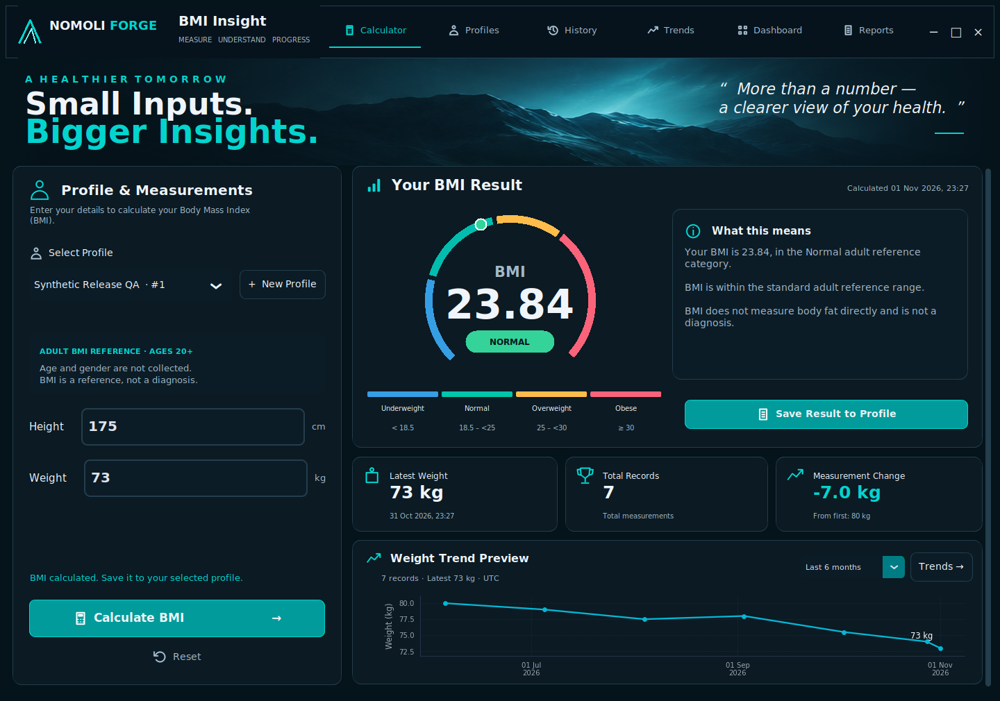
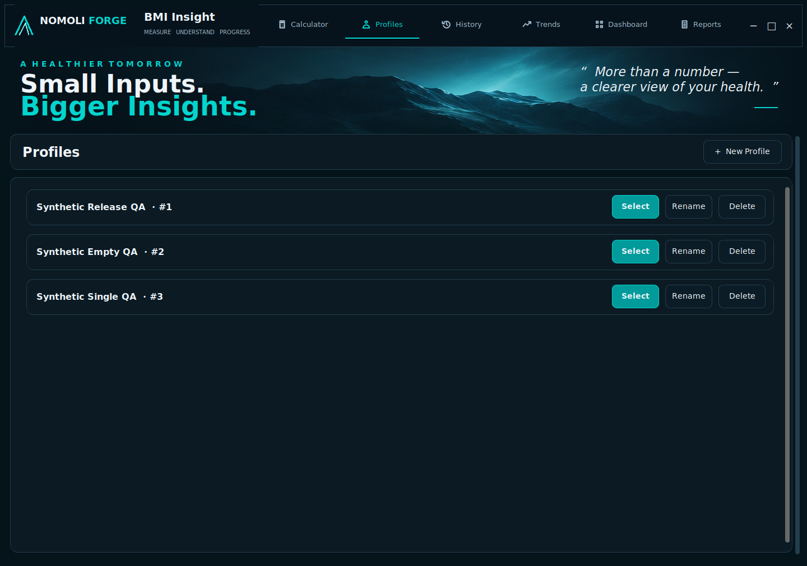
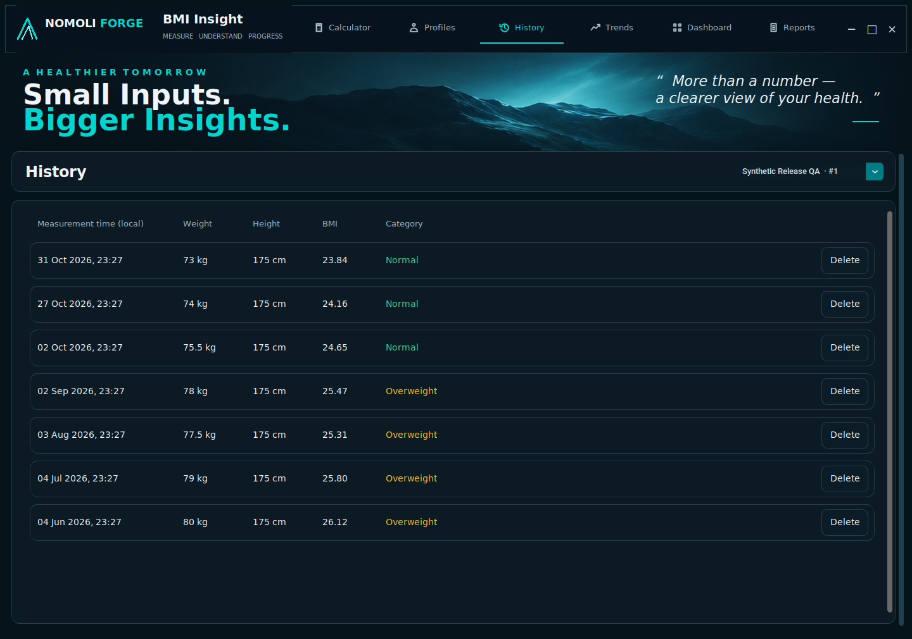
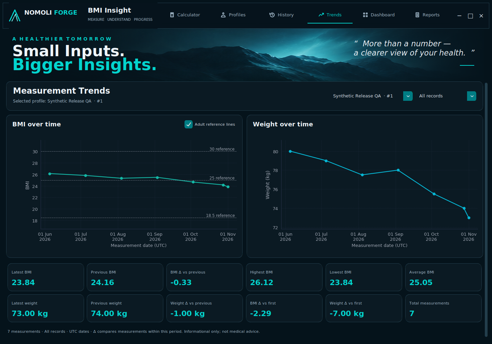
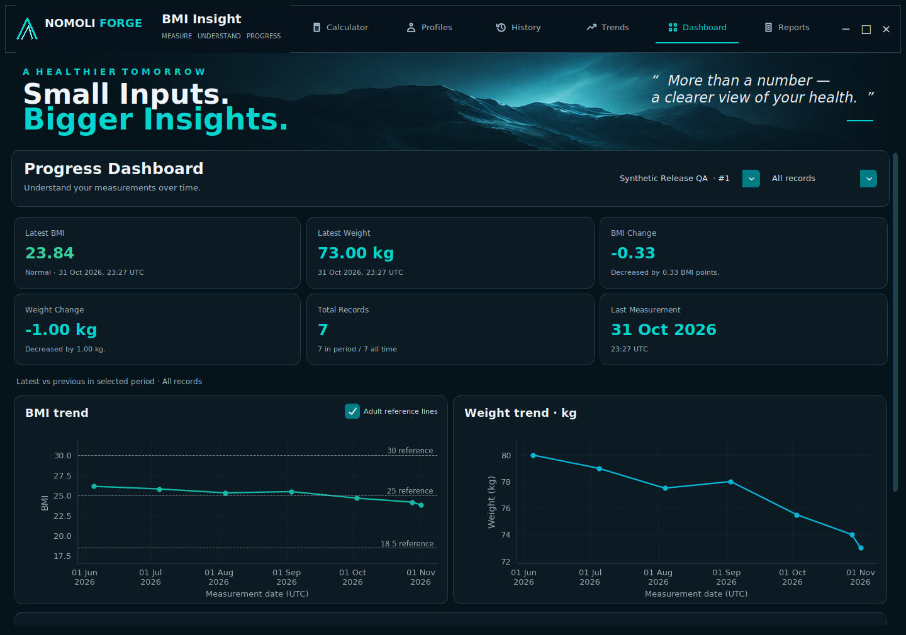
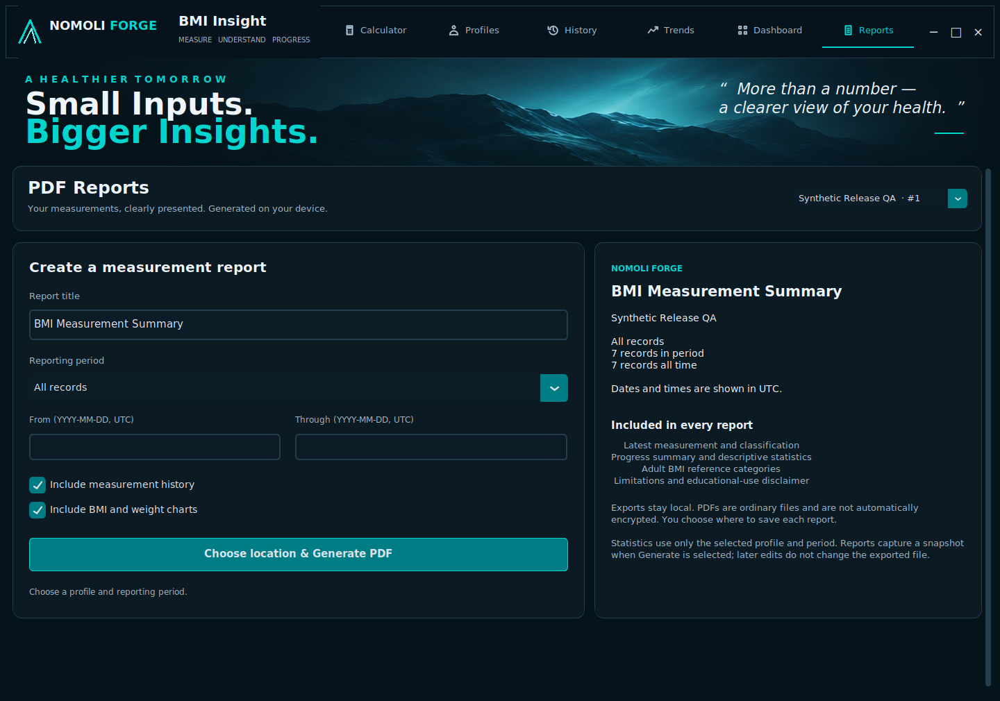
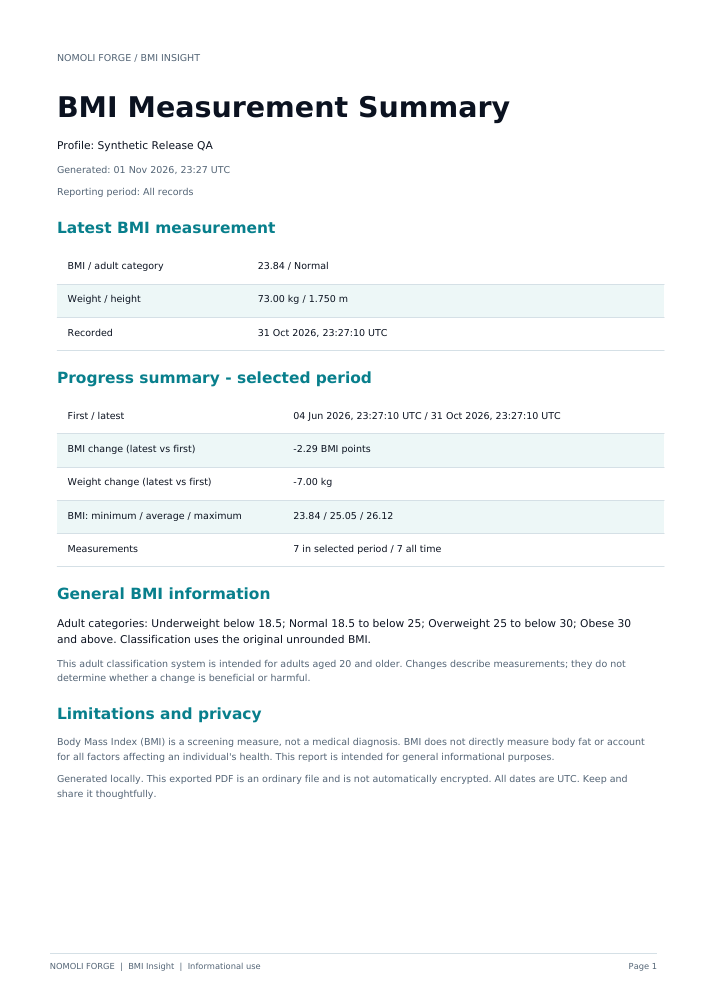
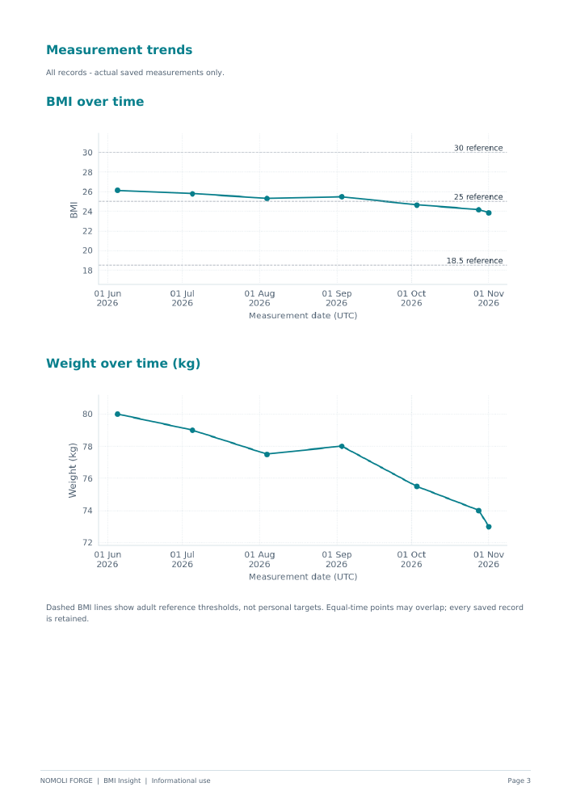

# BMI Insight — Task 08 Release-Readiness Report

NOMOLI FORGE · Oasis Infobyte Python Programming · Task 2 — Advanced BMI Calculator  
Audit date: 1 November 2026  
Audited baseline: `barriehassan/OIBSIP`, remote `main`, commit `f412ba9699cf8272ab9180ef5e6e200e9cb241a5`

## A. Executive summary

**Recommendation: conditionally ready, pending manual Windows verification.**

The supplied Task 03–07 implementation is present and matched the latest Task 07 remote tree before modification. The baseline suite passed 324 tests. Task 08 preserves the approved Vitality Analytics interface and modular architecture, corrects reproducible validation/storage error paths, clarifies the adult age scope, removes obsolete placeholder code/unused imports, and prepares current release documentation and screenshots.

Final automated result: **348 collected, 348 passed, 0 failed, 0 skipped**. No pytest warnings were reported. The actual desktop and entry point launched on Linux/Tk 8.6. Five representative PDF reports were generated and rendered for inspection. No unresolved critical defect was identified within the audited workflows. This is a scoped engineering audit, not certification against an independently supplied external assessment rubric or every possible device/filesystem.

No new major feature, AI recommendation, cloud integration, authentication, database migration or executable packaging was added. Password Forge and unrelated repository content were preserved. Task 08 changes have not been committed, pushed, merged or released.

## B. Completed features verified

| Area | Verification and result |
| --- | --- |
| BMI core | Weight / height² calculation, full-precision storage, two-decimal display and unrounded classification preserved. Boundary and adjacent-boundary tests remain passing. |
| Validation/conversion | Empty, alphabetic, invalid type, bool, negative, zero, NaN and infinity rejection; supported application ranges; metric/imperial equivalence; extreme feet overflow now controlled. |
| Adult scope | Calculator explicitly says ages 20+; PDF and README retain adult 20+ scope and educational limitations. No age/gender collection or personalized treatment advice. |
| Profiles | Create/select/rename, stable IDs, duplicates distinguished by ID, trimmed/max-length/control-character validation, confirmed deletion and database cascade. |
| SQLite | Initialization, app-data paths, foreign keys per connection, parameterized queries, transactional writes/rollback, closure, reopen persistence and controlled failures. |
| Measurement history | Recalculation through core, precision preservation, profile-scoped get/delete/history/count, chronological timestamp/ID order and explicit deletion confirmation. |
| Calculator/UI | Real gauge/classification, input feedback, explicit save, reset, correct button states, horizontal navigation, preserved mountain/navy/teal identity. |
| Charts | Real profile data, UTC periods, units, threshold toggle, empty/single/multiple records, timestamp ties, large-history case, reuse and cleanup. |
| Dashboard | Latest BMI/category/weight/date, changes versus previous, period/all-time counts, historical insights, recent records and refresh. |
| PDF | Selected-profile snapshot, presets/custom date ranges, content toggles, save dialog, background process, accurate tables/charts, pagination, disclaimers, controlled errors and safe overwrite semantics. |
| End-to-end | Create/calculate/save → History/Trends/Dashboard → real PDF worker → profile switch/isolation → confirmed deletion/refresh → close/reopen/persistence. |

The implemented feature set covers the task requirements supplied in this conversation. GUI imperial unit switching, age/gender fields and executable packaging are not claimed as implemented.

## C. Quality assurance results

### Automated execution

| Run | Collected | Passed | Failed | Skipped | Pytest warnings |
| --- | ---: | ---: | ---: | ---: | ---: |
| Task 07 baseline in current working copy | 324 | 324 | 0 | 0 | 0 reported |
| Task 08 final suite | 348 | 348 | 0 | 0 | 0 reported |

Final suite duration: 25.48 seconds. All original 324 test cases remain unchanged; 24 release cases were added in two files. No tests were weakened or deleted. Every database/export test uses temporary paths. Without a graphical display, desktop tests explicitly skip; the reported final run used an actual Xvfb display and did not skip them.

Environment: Linux, Python 3.12.3, Tk 8.6.14, CustomTkinter 6.0.0, Pillow 12.3.0, Matplotlib 3.10.8, ReportLab 4.4.9, pytest 9.2.0, pypdf 6.10.0. Declared requirements were checked against installed package metadata. The application parses under Python 3.10 grammar, but Python 3.10/3.11 execution was not performed. No dependency/configuration conflict was found; Task 08 adds no packages.

Coverage percentage: **not measured**; a coverage tool was not installed. Existing tests exercise the requested functional areas and new tests target reproduced defects, not a numerical coverage target. No Windows GUI tests or macOS GUI tests were executed. Windows storage-path selection is simulated in a unit test and is not presented as actual Windows verification.

### Desktop and visual inspection

- `main.py` launched with an isolated application-data directory, created its test database, remained running and emitted no stderr during the smoke launch.
- All six views were exercised. Screenshots captured at 1440×1010 and 1240×860, including long names, empty data, filters and successful report export.
- The complete workflow test closes its first desktop window and opens another against the same temporary database, verifying retained records and profile isolation.
- Native layout, navigation, gauge, cards, mountain hero and existing Calculator composition remain intact. The age-scope label is the only intentional Calculator wording change.
- Long names wrap on Profiles and Reports; dropdowns abbreviate while retaining IDs. Minimum-height screens scroll; charts keep readable heights rather than being compressed into one viewport.
- Existing tests cover input focus/Enter behavior, button states, minimum layout and chart/figure cleanup. No long-duration memory profiling or full accessibility certification was performed.

### Security/privacy review

Application SQL uses bound parameters. The schema-version PRAGMA interpolates an internal constant only. Service/repository operations require profile IDs; individual record lookup/deletion additionally requires that profile ID. A SQL-shaped Unicode profile name is stored literally in a regression test; it does not execute SQL.

No application HTTP/API/telemetry code, hardcoded credentials or matching private-key/token patterns were found in the scoped source scan. Offline calculation/storage/report generation was tested with socket connections blocked. Background worker IPC is local, not a cloud service. Sensitive values are not intentionally logged. User-facing storage/report errors omit raw exception details; exception causes remain available for debugging.

SQLite and exported PDFs remain unencrypted. Profiles are organizational separation, not authenticated security boundaries against filesystem access. Confirmed destructive operations and cascade policy are documented. Report snapshots deliberately preserve the profile selected when export begins, even if selection/records later change.

## D. Files modified

| Existing file (within Python-Task2-BMICalculator) | Reason |
| --- | --- |
| `app/core/conversions.py` | Convert extreme feet-plus-fraction overflow into ValidationError. |
| `app/database/validation.py` | Reject Unicode controls, formatting characters, surrogates and line/paragraph separators in profile names. |
| `app/database/connection.py` | Control rollback/close failures, maintain cleanup, and guide checking history before retrying an uncertain operation. |
| `app/reports/report_models.py` | Reject Unicode line/paragraph separators in titles consistently with the single-line title contract. |
| `app/reports/pdf_generator.py` | Remove an unused style import; rendering architecture is unchanged. |
| `app/ui/reports_view.py` | Remove unused Tk/theme imports. |
| `app/ui/window.py` | Explicit ages-20+ scope; reject invalid navigation without changing selection; remove obsolete Dashboard/Reports planned-feature branch. |
| `.gitignore` | Add local environments, sensitive dotenv files, logs, temporary files, coverage/build artifacts. Intentional demo PNGs remain included. |
| `README.md` | Replace accumulated milestone prose with current installation, workflow, architecture, privacy, limitations, verified status, author and internship guidance. Historical milestone docs remain intact. |

Added:

- `tests/test_release_regressions.py`: numeric overflow; Unicode controls/titles; SQL-shaped name; rollback/close errors; all four PDF categories/offline behavior; export race; simulated Windows path.
- `tests/test_release_workflow.py`: full desktop/export/delete/reopen workflow, invalid navigation, long names at minimum size.
- `docs/RELEASE_READINESS.md`: this A–J report.
- `docs/WINDOWS_VERIFICATION.md`: isolated-data Windows setup, workflow, dialogs, DPI and evidence checklist.
- `docs/SUBMISSION.md`: publication checks and a synthetic-data demonstration outline.
- `docs/screenshots/task08/`: 18 genuine Linux/PDF captures covering all views, long names, empty state and representative report pages.

Unchanged: BMI formula/classification, database schema, existing service interfaces, original tests, dependency declarations, launch script, Password Forge and repository-root files. No runtime database or generated PDF is included in the source candidate.

## E. Bugs found and fixed

1. **Raw conversion overflow.** `feet_inches_to_metres(10**400, 0.5)` previously raised OverflowError before validation. It now raises a controlled ValidationError. Whole and fractional extreme cases are tested; ordinary conversions are unchanged.
2. **Incomplete profile control-character validation.** The old check only rejected ASCII controls/DEL, accepting e.g. U+0085 and bidi formatting. Unicode category checks now reject problematic control/format/surrogate/line-separator characters. Ordinary Unicode letters remain accepted. Existing stored data is not rewritten or deleted.
3. **Uncontrolled database cleanup exceptions.** Injected SQLite rollback/close failures could escape as raw sqlite3 exceptions. These now remain inside the DatabaseError hierarchy; initialization wraps them as InitializationError. Tests verify closure, no unintended committed row after failed commit/recovery, and safe messages.
4. **Multiline report-title gap.** Unicode line/paragraph separators bypassed the title control check. They are now rejected before export.
5. **Obsolete navigation fallback.** A dead branch still said Dashboard/Reports were planned, and an unknown page could change active state before failing. Unsupported page names now raise ValidationError before state changes; obsolete wording is removed.

Usability/documentation refinements: visible adult-20+ scope, updated dependency/platform claims, precise Windows instructions, repository hygiene and removal of three unused imports. No design redesign or new feature was required.

## F. PDF verification

Synthetic data only; no real health/profile history was used. Test exports stayed outside the repository.

| Scenario | Saved records | PDF pages | Embedded chart images | Result |
| --- | ---: | ---: | ---: | --- |
| Empty profile | 0 | 3 | 0 | Honest empty state; no invented values/charts. |
| Single measurement | 1 | 3 | 0 | Accurate latest measurement; no previous/trend claim. |
| Several measurements | 7 | 3 | 2 | Actual BMI/weight charts, correct table and summary; exported through real UI worker. |
| All adult categories | 4 | 3 | 2 | BMI 17.50 Underweight, 22.50 Normal, 27.50 Overweight, 32.50 Obese from 2 m heights. |
| Long history and long title/name | 180 | 11 | 2 | Wrapped title/name, paginated table with repeating headers, complete history and readable charts. |

All PDFs were rendered to PNG. Inspected summary, empty/single, category, chart and long-table continuation/end pages show readable fonts, consistent A4 margins, non-overlapping content, clean footers/page numbers and fitting images. The maximum-length title wraps across several lines and can add a page; no content is truncated. The long report preserves chronological ordering and full history. Display values round only for presentation.

Automated checks verify PDF signature, searchable text, profile inclusion/exclusion, accurate BMI/category, inclusive custom-date edges, optional sections, pagination, embedded images, temporary resource cleanup, invalid destinations, permission failures and preservation of existing output after rendering failure. A race test verifies a file created by another writer during generation is not overwritten without authorization. Native Windows overwrite-dialog behavior still needs manual verification.

## G. Outstanding limitations

- **Windows manual verification remains outstanding:** launch, native dialogs/overwrite prompt, spawn-worker behavior, fonts and 100%/125%/150% DPI. Linux screenshots do not prove Windows appearance. Small screens may not fit 1240×860 logical pixels at high scaling.
- Other Python versions and macOS GUI were not executed. Python 3.12/Tk 8.6 is the verified configuration.
- No executable/installer is built. Source submission and direct Python launch are available; optional packaging is not a blocker in the provided task.
- One PDF export at a time; no cancellation/progress percentage. Normal closure waits. OS/process termination can leave a staging file; ordinary exceptions clean up.
- Non-overwriting atomic publication uses filesystem hard links. Filesystems that do not support them may return a controlled error; a supported local destination is required.
- PDF font coverage does not include full CJK/emoji/complex-script text. Unsupported glyphs produce a clear error. PDFs are not accessibility-tagged.
- Very large histories still use synchronous reads and GUI chart rendering. Figure cleanup is tested, but no extended memory/performance soak was conducted.
- Local SQLite/PDF data is not encrypted. There is no authentication, generic migration/backup UI, GUI imperial switch, age/gender collection, cloud sync or AI advice.
- Mountain artwork is cropped from the supplied approved mockup. Separate original/vector assets and independent redistribution rights were not supplied; provenance is documented.

No outstanding critical defect was observed within the tested scope. These limitations and platform checks qualify the release recommendation.

## H. Repository status

Remote repository: `barriehassan/OIBSIP`; inspected branch: `main`; baseline head: `f412ba9699cf8272ab9180ef5e6e200e9cb241a5` (Task 07).

The provided OIBSIP folder is a source snapshot without `.git` metadata. A Git inspection reported **not a git repository**. Consequently there is no local active branch or staged/unstaged/untracked Git-index status to report. No Git repository was initialized and no history was reset or rewritten. Before changes, all repository file blobs matched the remote Task 07 tree. A before/after file manifest identifies modified/new files, and verifies Password Forge and unrelated root files remain unchanged.

Task 08 edits are local source changes only: **not committed, not pushed, no merge, no release**. The release candidate excludes environments, caches, runtime SQLite files, generated personal reports, temporary exports and build artifacts. Synthetic screenshot PNGs are intentionally retained. Publication awaits explicit approval.

## I. Final recommendation

**Conditionally ready, pending identified checks.**

The supplied functional requirements are implemented and audited, the 348-test suite passes, PDF output is verified, documentation and genuine screenshots are prepared, and no tested critical defect remains. Complete the Windows checklist and review the disclosed limitations before calling this a fully verified Windows release. The source candidate is suitable for review and preparation of the internship demonstration.

## J. Next steps

1. Install/update dependencies and launch on Windows using the README commands; activation and weakened security settings are unnecessary.
2. Follow [Windows verification](WINDOWS_VERIFICATION.md) using an isolated temporary database. Record versions, scaling, counts, dialog/worker behavior and screenshots. Report failures before approval.
3. Use [submission/demo guidance](SUBMISSION.md) to demonstrate calculation/validation, profiles/history, charts/Dashboard, export, isolation and persistence using synthetic measurements.
4. Review the Task 08 candidate and authorize commit/push only when satisfied. No publication or further development begins automatically.

## Capture index — Linux / Tk 8.6

Additional minimum-size/long-name/empty-state captures are in `screenshots/task08/`. All measurements shown are deliberately synthetic QA records.
