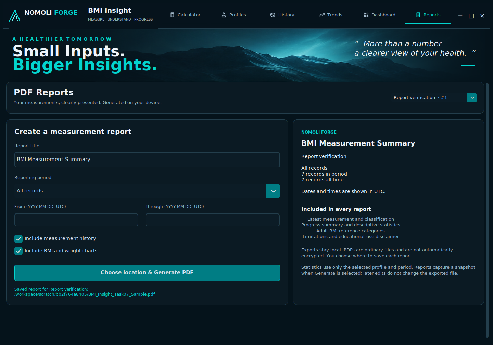
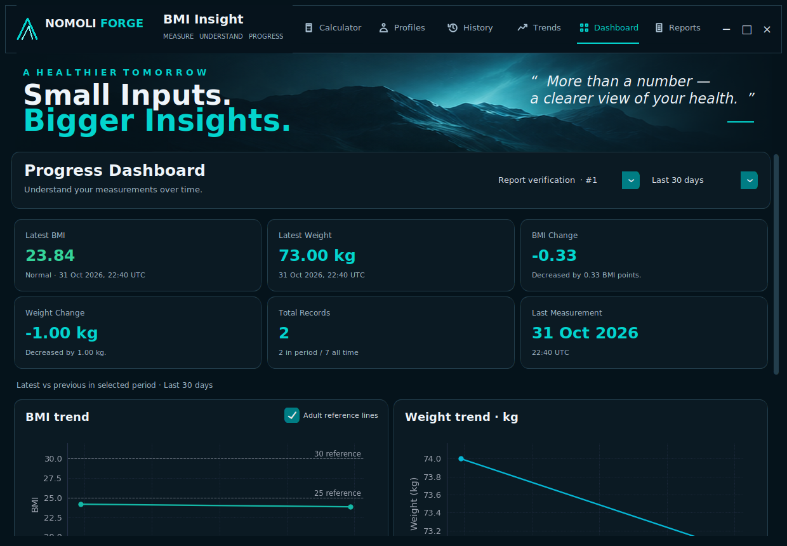
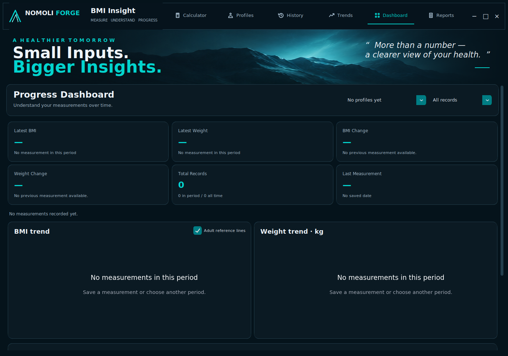
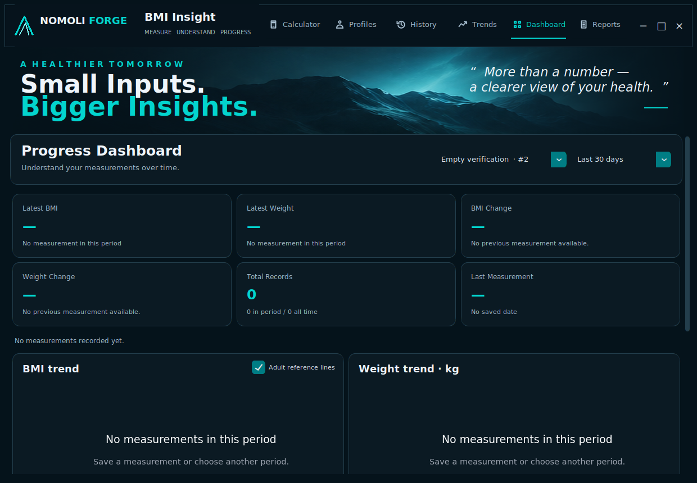

# Task 07 — Dashboard and PDF reporting review

Implemented against Task 06 commit `e066b5a730c08291fc0225b7ab285944cbeff04d` in `barriehassan/OIBSIP`. All local source blobs matched that remote tree before editing. The provided working copy is a source snapshot without its own `.git`, so a local Git status is unavailable. No commit, push, merge or release was performed.

## Completed functionality

- Profile-specific Progress Dashboard: six summary cards; BMI/category/date, weight/date, latest-versus-previous changes, period/all-time counts, last measurement timestamp.
- Existing BMI/weight charts with period filters, adult reference toggle, full precision, deterministic timestamp/ID order and explicit empty/single-record behavior.
- Highest/lowest/mean BMI, first/latest dates and four most recent selected-period records; working Calculator action; scrollable minimum-size layout.
- Reports page: profile selector, title, preset/custom inclusive UTC dates, history/chart switches, native save dialog and success/error feedback.
- ReportLab A4 export: printable navy/teal design, searchable embedded fonts, actual-data charts, repeated table headers, page numbers, educational categories and adult-20+ disclaimer.
- Snapshot-based export in a spawned process keeps Tk responsive and Matplotlib state isolated. Normal closure waits for export completion. Profile edits after capture do not mutate the in-progress export.
- Atomic output with explicit overwrite semantics and controlled errors; no personal reports or databases included in source.

## Architecture and files

New application files:

```text
app/services/dashboard_service.py
app/services/report_service.py
app/reports/__init__.py
app/reports/report_models.py
app/reports/report_styles.py
app/reports/pdf_generator.py
app/ui/dashboard_view.py
app/ui/reports_view.py
```

New test files: `test_dashboard_service.py`, `test_reports.py`, `test_dashboard_reports_ui.py`.

Modified: `app/ui/window.py` (navigation, refresh and close coordination), `requirements.txt`, `.gitignore`, project README and repository README. Added this review and eight screenshots under `docs/screenshots/task07/`. Core, repositories, database schema, existing service APIs, prior tests and Password Forge are unchanged.

Public non-GUI interfaces:

- `DashboardService(analytics).snapshot(profile_id, period='All records', now=None, all_data=None)` returns period analytics plus all-time count.
- `ReportOptions(title, period, include_history, include_charts, start_date, end_date)` validates inputs.
- `ReportService(profiles, history).prepare(profile_id, options, now=None)` returns a frozen `ReportData` snapshot.
- `generate_pdf(data, output_path, overwrite=False)` returns the published absolute path or raises `ReportError`.

Report preparation uses existing services. Rendering executes no SQL and holds no Tk widgets. Matplotlib Figures and in-memory PNG buffers are cleared/closed. ReportLab >=4.4,<5 is the runtime addition; pypdf >=6,<7 is test-only tooling kept in the existing single requirements file. Verified versions: ReportLab 4.4.9, pypdf 6.10.0, Matplotlib 3.10.8, CustomTkinter 6.0.0.

## Verification

- Baseline: 276 passed / 0 failed / 0 skipped on the unchanged Task 06 archive, after restoring Xvfb/Tk dependencies. Initial headless baseline: 260 passed / 0 failed / 16 GUI skips.
- Final suite: **324 passed / 0 failed / 0 skipped** (48 new cases; all 276 previous cases preserved).
- Real Tk 8.6 application launched on Linux at 1440×1010 and 1240×860. Real process-worker export completed while navigation remained functional.
- All data came from temporary SQLite databases. No real user profile/history was opened or modified.
- Short report: 7 actual service-saved verification records; 3 A4 pages, 2 embedded chart images, correct classification/values and readable tables.
- Empty report: 3 pages with explanatory empty states and no fabricated charts.
- Long report: 162 records, 8 pages with repeated history headers. Automated pagination case uses 160 records. Table continuation and page margins inspected.
- PDF signature, text/Unicode escaping, profile isolation, selected dates, inclusive day edges, precision, missing paths, permission failures, failure cleanup and existing-file preservation are tested.
- Profile creation/switch/deletion, measurement save/deletion, empty/single state, Dashboard reuse, chart cleanup, minimum-size scrolling, cancelled dialogs, worker failure and close-during-export behavior are tested.

## Captures








The approved top navigation, mountain hero, Calculator composition and navy/teal styling remain intact. Dashboard content scrolls below the fixed hero at smaller heights; charts retain their readable height instead of compressing all content into one screen. Reports use a three-to-two column layout. PDF styling intentionally uses white paper with restrained navy/teal accents.

## Remaining limitations and review decisions

- Windows launch, DPI scaling, native save/overwrite dialog and spawned worker behavior still require local verification. No Windows testing is claimed.
- Exports are unencrypted, ordinary local files. No upload, cloud sync, authentication or AI recommendations exist.
- Full CJK/emoji/complex-script PDF typography is not supported by the reused font. Unsupported characters produce a controlled error. Latin accents and XML-like characters are tested.
- One export at a time; no cancellation/progress percentage. Closing waits for completion. OS/process termination can leave a staging file; ordinary exceptions clean it up.
- Database reads and Dashboard rendering remain synchronous; extremely large histories may take longer. Export rendering runs separately.
- Custom dates are available in Reports; Dashboard uses the established Task 06 preset periods. Report summary changes compare latest versus first; Dashboard change cards compare latest versus previous, both explicitly labelled.
- No general database migration system or backup UI is introduced. Existing age/gender omissions remain.

Task 07 is ready for review and local Windows verification. Task 08 has not started. Commit/push requires explicit approval.
