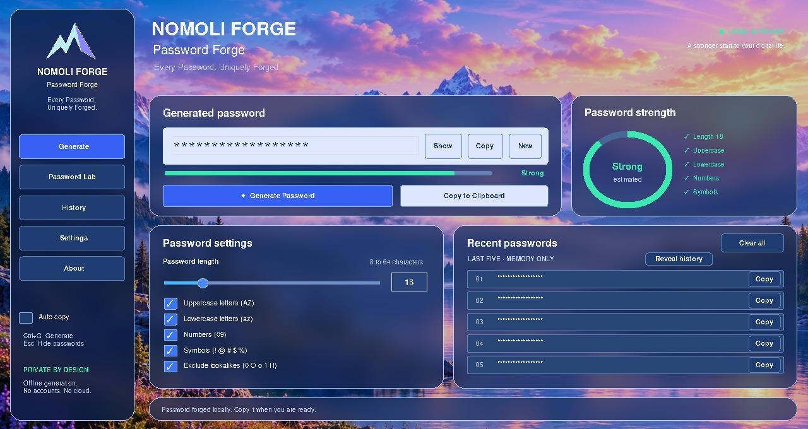
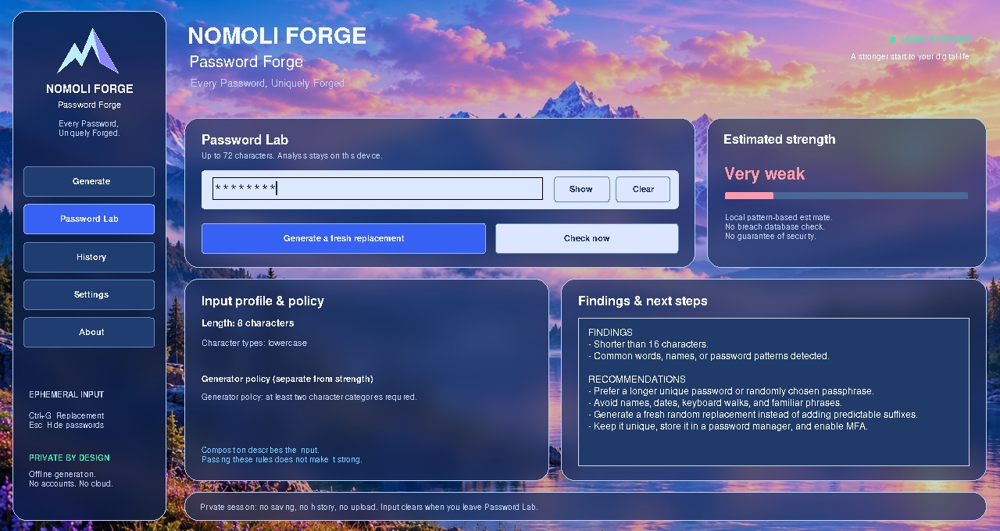

# NOMOLI FORGE — Password Forge

**Every Password, Uniquely Forged.**

An offline Python desktop application for creating random passwords and assessing passwords you enter yourself. Built for Hassan Barrie's **Oasis Infobyte Python Programming internship**, under the NOMOLI FORGE brand.

**Task 05 status:** source release candidate approved for commit and publication. No executable installer or GitHub release is included. The password-generator task keeps its existing `Python-Task3-PasswordGenerator` folder name; confirm task numbering against your assigned brief before submission.

## Features

- Secure random generation using Python `secrets`, with length **8–64**.
- Uppercase, lowercase, numbers and symbols; every selected category is represented.
- Optional exclusion of lookalikes: `0 O o 1 l I`.
- Masked output, Show/Hide, regeneration, explicit copy feedback and optional auto-copy.
- Five-entry, memory-only history with reveal, copy and clear controls.
- **Password Lab:** local pattern-based estimation, descriptive character checks, separate policy feedback, recommendations and fresh random replacements.
- Mountain artwork, frosted blue panels, sidebar shortcuts and keyboard controls.
- A command-line generator requiring only Python's standard library.

## Technology stack

| Component | Technology |
| --- | --- |
| Language | Python 3.10+; tested here with 3.12.14 |
| Desktop | Standard Tk / tkinter; tested here with Tk 9.0.4 |
| Artwork and glass compositing | Pillow 12.3.0 |
| Clipboard | pyperclip 1.11.0, with Tk fallback |
| Human-password estimation | Bundled zxcvbn-python 4.5.0, MIT licensed |
| Automated testing | pytest 9.2.0 and unittest |

Earlier prototypes used CustomTkinter. The current application uses **standard Tk and Pillow**; CustomTkinter is not a dependency.

## Project structure

```text
Python-Task3-PasswordGenerator/
├── main.py                    # Desktop entry point
├── app/
│   ├── cli.py                 # Standard-library command-line generator
│   ├── core/                  # Generation, validation and separate strength services
│   ├── services/              # Clipboard adapter
│   ├── ui/                    # Desktop shell, Lab view, controller and artwork
│   └── _vendor/zxcvbn/        # Local estimator, dictionaries, license and provenance
├── assets/backgrounds/        # Bundled mountain image and replacement guidance
├── screenshots/               # Masked demonstration captures
├── tests/                     # Backend, privacy, failure-path and desktop tests
├── docs/                      # Design, validation, release report and submission checklist
├── pytest.ini                 # Test discovery/import configuration
├── requirements.txt           # Pinned runtime packages
├── requirements-dev.txt       # Runtime packages plus pytest
├── run_windows.bat            # Optional shortcut after setup
└── .gitignore
```

## Prerequisites

- Python **3.10 or newer**, with tkinter and the Windows `py` launcher.
- A graphical desktop. The minimum client area is **1000×680**; typical 1366×768 displays at normal scaling are supported by the layout.
- Internet access for the first dependency installation. Generation and Lab evaluation work offline afterward.

Check Python and Tk from PowerShell or the VS Code terminal:

```powershell
py -3 --version
py -3 -m tkinter
```

The second command should open a small Tk test window. Close it before continuing.

## Windows installation

Clone the repository, or download and extract its ZIP. If you cloned it:

```powershell
git clone https://github.com/barriehassan/OIBSIP.git
cd OIBSIP\Python-Task3-PasswordGenerator
py -3 -m pip install --user -r requirements.txt
```

If you downloaded a ZIP, open a terminal in the extracted project folder containing `main.py`, then run the final install command above. The runtime versions are pinned to those tested for this candidate.

### Run the application

From the folder containing `main.py`:

```powershell
py -3 main.py
```

Use the same Python interpreter for installation and launch. The supported command above installs into and runs the Python selected by `py -3`.

If you prefer a project virtual environment, create it with `py -3 -m venv .venv`, then use `.\.venv\Scripts\python.exe` for both pip and the application. Do not mix a virtual-environment installation with a `py -3` launch that selects a different interpreter.

`run_windows.bat` is optional. It uses `.venv\Scripts\python.exe` if present, otherwise `py -3`, and never installs packages automatically. If Windows blocks the shortcut, use the direct startup command above; do not disable Windows security controls.

### Update an existing clone

Close the running application. From the OIBSIP repository folder:

```powershell
git pull --ff-only origin main
cd Python-Task3-PasswordGenerator
py -3 -m pip install --user -r requirements.txt
py -3 main.py
```

For an uncommitted review package, extract it to a **separate folder** to review it without overwriting your existing working copy. The Task 05 source candidate has been approved for publication; review packages may reflect the earlier uncommitted review stage.

## Using Password Forge

1. Choose a length and at least two character categories.
2. Select **Generate Password**. Output starts masked.
3. Use **Show**, **Copy**, or **New**; enable auto-copy only if you want it.
4. The **History** sidebar shortcut returns to the generator dashboard and its recent-password card. History is hidden until revealed.
5. **Settings** returns to the dashboard and focuses the length field. **About** opens application/privacy information.

**Ctrl+G** generates; **Esc** hides output and history. Tab moves through canvas actions and native fields; Enter/Space activates a focused canvas action. Long generated passwords can be inspected using the field's horizontal scrolling. Long history values are shortened only in the preview; Copy uses the complete value.

### Password Lab

Select **Password Lab**, then enter or paste a disposable password. Show/Hide and Clear are beside the field. Evaluation updates after a short typing pause; **Check now** evaluates immediately.

The rating comes from local zxcvbn pattern matching. Length and character composition are descriptive. The generator's policy—8–64 characters and at least two categories—is reported **separately** from estimated strength.

**Generate a fresh replacement** uses the existing secure generator. It does not append predictable suffixes or reuse your input. Neither manual input nor Lab replacements enter generator history or trigger generator auto-copy. **Ctrl+G** in Lab requests a fresh replacement; **Esc** masks the field.

Input is cleared when leaving Lab, opening About or closing the app. Analysis supports **1–72 Unicode code points**; longer input receives no score and is never silently truncated. The input buffer is limited to 4096 characters.

## Testing

Install test dependencies from the project folder:

```powershell
py -3 -m pip install --user -r requirements-dev.txt
py -3 -m pytest -q
```

The ordinary run skips three opt-in real-window tests. To include them on a desktop:

```powershell
$env:RUN_DESKTOP_TESTS = "1"
py -3 -m pytest -q
Remove-Item Env:RUN_DESKTOP_TESTS
```

The desktop tests briefly open windows. They use disposable values and simulated clipboard failures; they do not intentionally replace your OS clipboard.

Dependency-free generator/controller checks:

```powershell
py -3 -m unittest discover -s tests -p test_portable.py -v
```

Final executed counts and the environment are in [validation notes](docs/VALIDATION.md). See the [release-readiness report](docs/RELEASE_READINESS.md) for the audit, fixes and remaining manual checks.

## Screenshots

Actual application captures from Linux/Tk 9 using a **1366×768 virtual display**, with a 1280×680 client area. They demonstrate the current UI, not a Windows certification. Generated values and history are masked; Lab uses disposable sample input.

| Generator | Password Lab |
| --- | --- |
|  |  |

[History view](screenshots/03-history.jpg) · [Minimum-size layout](screenshots/04-compact.jpg)

Before submission, you may add authentic Windows captures using disposable data. Never commit real passwords, account credentials or private desktop content.

## Security and privacy

- Generation uses OS-backed `secrets.choice` and rejection sampling to satisfy every selected category. Python's simulation-oriented `random` module is not used for password creation.
- This app has no password database, telemetry or external evaluation service. The bundled estimator works without a separate zxcvbn installation.
- Generator history holds up to five passwords in process memory. **Clear all** clears history; the current generated output remains until replaced or the app closes.
- Clearing fields/history drops application references; Python/Tk cannot guarantee secure memory zeroization. OS memory inspection, swap and screen capture are outside this app's control.
- Explicit copying places a value on the system clipboard. Other applications or clipboard managers may read or retain it after this app exits. Clipboard failures return feedback instead of crashing.
- Lab input is never automatically copied, added to history, logged, saved, or uploaded. Raw estimator matches and exception details are not displayed.
- Generator strength is a rough length/alphabet upper-bound estimate. Lab strength is a pattern-based guessability estimate. Neither is a security guarantee or a breach-database check.
- The CLI prints the generated password to the terminal; scrollback and redirected output can retain it. Avoid showing real credentials in demos.

## Known limitations

- Windows was launched and manually exercised by the author; this automated QA run used Linux/Tk 9. Windows/macOS DPI, fonts, clipboard and keyboard behavior still need the final [manual checklist](docs/SUBMISSION.md).
- At high display scaling, the logical desktop may be smaller than 1000×680. This layout does not support very small logical screens.
- Password Lab dictionaries are incomplete and language dependent. Familiar personal/cultural patterns may be missed. No crack-time promises or compromise-history claims are made.
- No password vault, passphrase generator, breach lookup, installer, signed binary or executable packaging is included.
- Dependency pins improve repeatability but are not a claim that all dependencies have been externally vulnerability-audited.

## Troubleshooting

- **Missing package:** run the install command with the same interpreter used to launch `main.py`.
- **Lab says Setup needed:** ensure the complete `app/_vendor/zxcvbn` directory is present, then restart. No separate zxcvbn pip installation is needed.
- **Lab says Unavailable:** clear the field and retry with disposable input, then restart if needed. Exception details are deliberately hidden to protect input.
- **No graphical display/Tk:** use a local desktop Python installation with Tk. The CLI works without Tk or desktop packages: `py -3 -m app.cli --length 20`.
- **Clipboard unavailable:** reveal output and copy it manually. Linux clipboard behavior depends on the desktop session.

## Author and acknowledgments

**Hassan Barrie** · [GitHub: barriehassan](https://github.com/barriehassan) · **NOMOLI FORGE**

Prepared for the Oasis Infobyte Python Programming internship. This is an independent project; use of the internship name does not imply endorsement. Follow the supplied assignment, attribution and video-submission rules.

Acknowledgments: Python/Tk, [Pillow](https://github.com/python-pillow/Pillow), [pyperclip](https://github.com/asweigart/pyperclip), [pytest](https://github.com/pytest-dev/pytest) and [zxcvbn-python](https://github.com/dwolfhub/zxcvbn-python). Bundled estimator attribution, import-only modifications and its MIT license are preserved in [VENDOR.md](app/_vendor/zxcvbn/VENDOR.md) and [LICENSE.txt](app/_vendor/zxcvbn/LICENSE.txt). The mountain image was supplied for this project; confirm its redistribution rights before a broader commercial release. This review does not assign a new license to the application's own code or artwork.
