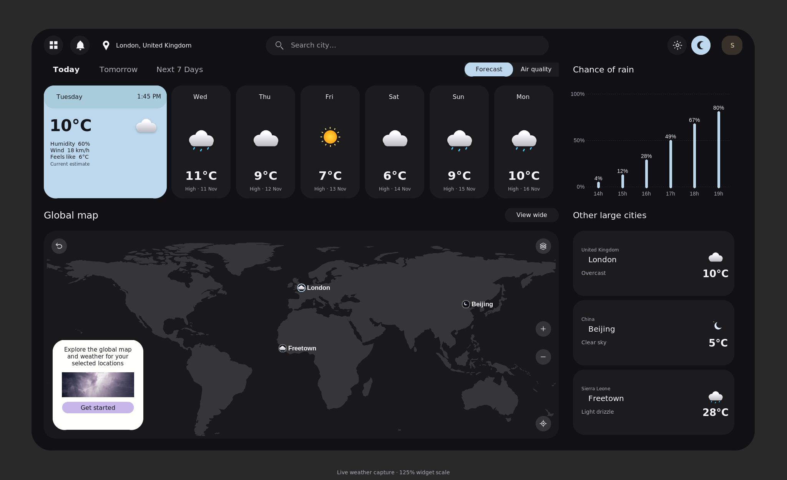

# NOMOLI FORGE — SkyCast

**Know the Sky. Plan Your Day.**

A Windows-targeted Python desktop weather application by **Hassan Barrie** (`barriehassan`) for the **Oasis Infobyte Python Programming internship — Task 4, Basic Weather App, Advanced Tier**.

SkyCast combines live provider retrieval with a near-black CustomTkinter dashboard: selected-location header, central search, horizontal daily cards, Chance of Rain, Global Map and Other Large Cities. Current values are model estimates, not direct local sensor observations. No demonstration weather is injected during normal operation.

**Release status:** Task 06 release candidate, conditionally ready pending native Windows acceptance. Tasks 01–05 are published; Task 05 baseline is `87fe883427faf29f11f7acab4cc01b94a7669bb5`. Task 06 was published in commit f8f573e. This package includes the subsequent dashboard alignment correction. Read the [final audit](docs/TASK06_RELEASE_AUDIT.md) and [Windows checklist](docs/WINDOWS_ACCEPTANCE.md) before submission.



## Features

- City, country-qualified city and provider-supported postal-code search, with candidate selection for ambiguous results.
- Current temperature, humidity, wind, condition, apparent temperature and observation time.
- Six genuine upcoming hourly forecasts and seven dated daily slots (at least five supported when the provider supplies them).
- Celsius/Fahrenheit switching across cards, hourly forecasts, city readings, feels-like, chart and speech.
- Percentage rain chart and hourly temperature chart with unavailable values/gaps preserved.
- Selected-date sunrise/sunset in the location's timezone.
- Interactive geographic overview with pan, zoom, reset, selected-location centering and marker visibility.
- Up to three session city cards; separate persistent favorite locations.
- Local weather cache with download timestamps, stale labels and network-failure fallback.
- User-triggered local Windows speech with Stop.
- Optional, consent-based approximate IP location detection with result confirmation.

## Install and launch on Windows

Use **Python 3.12 with Tcl/Tk 8.6**, the validated Python/Tk combination. Runtime source uses Python 3.11+ syntax; other combinations need verification. Tk 9 is rejected with an actionable message because earlier visual checks found incompatible rendering. From `Python-Task4-WeatherApplication/` in PowerShell:

```powershell
py -3.12 -m venv .venv
.\.venv\Scripts\python.exe -m pip install -r requirements.txt
.\.venv\Scripts\python.exe main.py
```

Use the same interpreter for installation and launch. No batch file or security-setting change is required. Fresh weather and initial package installation require internet. Previously cached weather can be viewed offline by selecting a saved favorite; cached data is not a fresh offline forecast. The app opens without automatically requesting a location.

For development and tests:

```powershell
.\.venv\Scripts\python.exe -m pip install -r requirements-dev.txt
.\.venv\Scripts\python.exe -m pytest -q -ra
```

Linux needs a working desktop display or Xvfb and Tk 8.6. Use `.venv/bin/python` after creating the environment with `python3 -m venv .venv`. Desktop tests explicitly skip if a display is unavailable. Native Windows execution, SAPI5 audio and DPI behavior remain pending; Linux screenshots do not establish those results.

## Using SkyCast

**Search:** Enter a city such as `Freetown`, a qualified name such as `London, United Kingdom`, or a supported postal code. Select the correct city, region and country when candidates appear. Postal coverage is not universal; a code may resolve differently between countries. Always check the displayed country and coordinates. Unknown/invalid locations produce inline feedback. Search text remains editable and can differ from the selected location shown beside the pin.

**Forecasts:** Today shows current conditions and the next six actual hours. Tomorrow selects the next local calendar day. Next 7 Days and individual cards select dates; daily temperatures are labeled high/low. Previous/Next navigates six-hour windows for selected future dates. Missing days/hours remain unavailable. All dates use the selected place's timezone, independent of the computer timezone. Full report provides timestamps, UTC offsets and partial-coverage details.

**Details and units:** Open Forecast or the grid menu to access Listen, Save, Favorites and Detect My Location, and to reveal hourly details, statistics, °C/°F, Refresh, Add current city, sunrise/sunset and the temperature chart. Ctrl+U toggles units without fetching again. Canonical values stay in Celsius, avoiding repeated-conversion drift. Wind remains km/h; humidity and rain probability remain percentages. Rain chance is explicitly labeled with its forecast hour and is not rainfall volume. Chart lines break across missing temperatures/hours; a lone sample is a dot.

**Map and cities:** The column shows the selected city and up to three session pins. Choose Load forecast on a suggested city to retrieve its weather and add its map marker. Add current city pins the selected place. Click a city or map pin to select it. Right-click a city or press Shift+F10 on its name for update/removal and retrieval details. Old readings or failed refreshes show Cached with download time. Drag the map to pan; +/− zoom; reset restores the overview; layers toggles pins; locate centers the selected place. View wide opens a larger map. The map uses a 2:1 equirectangular land asset cropped to fill its viewport without stretching. Pins show last-retrieved selected-city conditions, not worldwide live coverage. There are no radar, wind-field or ocean layers. Air quality explicitly reports unavailable data.

**Favorites:** ☆ Save stores the current resolved location. Favorites opens saved rows; choose one to load it or Remove to delete it. Up to 50 favorites persist across restarts. Duplicate identities are ignored; different coordinates/countries remain distinct. These differ from the three session city cards.

**Voice:** On Windows, Listen to Weather starts an installed SAPI5 voice; Stop interrupts it. It reads the selected location, actual current values and active temperature unit. Cached summaries announce last-retrieved conditions and download time. Search, location/unit changes and closure stop obsolete speech. The engine runs in an isolated process, not on Tk's event loop. `requirements.txt` installs Windows-only pyttsx3 and its Windows dependencies. An installed Windows voice and audio output are required. Other platforms show Voice unavailable. No microphone, audio recording or cloud TTS is used.

**Cache:** Valid snapshots less than 20 minutes old can be reused; Refresh forces a network attempt. A network failure may use a valid older snapshot marked recent/stale cache with its original download time. Corrupt/provider-error responses are not disguised as successful retrievals. Forecast dates never shift forward to pretend old data is current. Cache retention is seven usable days, at most 30 locations and 500 KB per record; cleanup runs on writes. Clear weather cache preserves favorites and the already displayed snapshot. A future successful request can cache new weather.

**Approximate location:** Detect My Location displays disclosure before any IPWHOIS.IO request. Continue permits the HTTPS lookup; Use this location separately confirms its result. VPNs, proxies and mobile networks can identify the wrong place. Cancel or Search manually keeps manual search available. SkyCast does not retain the IP address. Real IP lookup was not performed during cloud validation.

**Keyboard:** Ctrl+L focuses search; Enter/Space activates supported controls; arrow keys navigate candidates/days; Escape cancels selection. Native screen-reader compatibility is unverified.

## Architecture and dependencies

| Layer | Responsibility |
|---|---|
| `main.py` | Guarded desktop entry point and dependency/Tk errors |
| `app/core/` | Immutable models, validation, condition mapping, units and forecast selection |
| `app/providers/` | Allowlisted HTTP transport, geocoding and Open-Meteo normalization |
| `app/services/` | Weather orchestration, cache policy, isolated voice and opt-in IP lookup |
| `app/storage/` | Transactional local SQLite; separate connections per operation |
| `app/ui/` | Two-worker controller, stale-result protection, presentation and real Tk widgets |
| `assets/` | Bundled licensed land map and attribution |
| `tests/` | Offline deterministic tests with temporary data and mocked audio/HTTP |

Runtime requirements pin requests, tzdata, CustomTkinter, Pillow and Windows-only pyttsx3. pytest is development-only. SQLite, multiprocessing, zoneinfo and the Canvas charts use Python's standard library. Matplotlib is not used. `scripts/build_map.py` optionally needs pyshp to rebuild the already bundled map; it is not a runtime dependency. No API key is required by the configured free endpoints.

## Privacy, reliability and attribution

Favorites and normalized cache live at `%APPDATA%/NOMOLI_FORGE/SkyCast/skycast.sqlite3` on Windows. Linux uses `$XDG_DATA_HOME/NOMOLI_FORGE/SkyCast/skycast.sqlite3` or `~/.local/share/...`. These records include saved place names/coordinates and weather metadata; they are local plaintext data protected by operating-system account permissions, not application encryption. Do not commit this database. Corrupt entries/storage errors produce safe notices and preserve online search. No accounts, telemetry or cloud synchronization are implemented.

Weather/search requests send queries or coordinates to Open-Meteo. Hosted icon requests contact OpenWeather; local original illustrations remain available offline. Each service sees the requesting network address. IP detection is optional; speech is local. HTTP uses TLS verification, fixed endpoints, explicit timeouts, bounded responses and controlled retries. Active sockets cannot be forcibly cancelled, but late results are discarded. Workers are daemonized and shutdown waits are bounded.

[Open-Meteo](https://open-meteo.com/) weather data is attributed under [CC BY 4.0](https://creativecommons.org/licenses/by/4.0/); SkyCast converts units and documents local-day adjustments. Its [free-service terms](https://open-meteo.com/en/terms), checked 2026-11-02, permit noncommercial usage subject to rate limits. An internship prototype does not automatically authorize later commercial/promotional distribution. Geocoding credits GeoNames; icons credit OpenWeather; Natural Earth land data is public domain. Full [asset notices](assets/ATTRIBUTION.md) and [provider review](docs/TASK06_RELEASE_AUDIT.md#i-api-and-licensing-review) describe scope and limitations.

## Verification and remaining checks

See [Task 06 audit](docs/TASK06_RELEASE_AUDIT.md) for exact test totals, fixes, FR-01–FR-14 evidence, security review and remaining actions. The scripted Linux acceptance uses actual retrieved weather, simulated failures explicitly labeled as such, and temporary databases. Screenshots are [indexed here](screenshots/README.md). No Windows audio/DPI or real public-IP accuracy pass is claimed. An installer/executable, AI recommendations and cloud accounts are outside this release candidate.

Historical planning and reports remain under `docs/`; their stage-specific pending/completed statements are historical. The current status is this README and the Task 06 audit.
