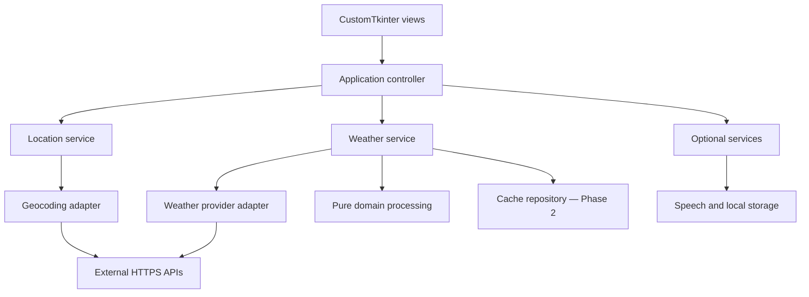

# SkyCast — Architecture

**Task 01 design proposal · 2 November 2026**

## Boundaries and dependencies

The controller composes dependencies. The core imports no GUI, HTTP, SQLite or speech library. Adapters normalize external structures before services return them. Views receive display models, not provider JSON. SQL is confined to repositories. No module imports code from Password Forge or BMI Insight.

| Layer | Responsibility | Must not do |
|---|---|---|
| Core | Immutable models, validation, unit conversions, forecast grouping, condition interpretation | Network, GUI or filesystem operations |
| Providers | Fixed HTTPS endpoints, request/response contracts, normalization, typed failures | Select widgets or store user preferences |
| Services | Coordinate search, fetching, optional cache and speech | Depend on concrete widgets |
| Controller | Selected location/date/unit, request lifecycle and view models | Embed API parsing or SQL |
| Presentation | Layout, inputs, accessibility, charts and map rendering | Block on requests or speech |
| Storage, Phase 2 | Versioned local preferences/favorites/cache | Mutate weather data to conceal expiry |

## Model contracts

Use frozen dataclasses and tuples where appropriate. All instants are aware UTC datetimes internally; local calendar dates are `date` values. All numeric fields reject NaN/infinity and impossible units/ranges. Optional values use `None` plus availability metadata, never zero as a sentinel.

| Model | Fields and invariants |
|---|---|
| Location | provider, provider_id, name, region?, country, country_code, latitude [-90,90], longitude [-180,180], IANA timezone; stable identity separate from display label |
| Condition | canonical category, description, provider, original_code, is_day?; unknown code yields honest unknown state |
| CurrentWeather | valid_at_utc, temperature_c?, feels_like_c?, humidity_pct?, wind_kmh?, condition, precipitation_mm?, source_kind; Open-Meteo current data use model-estimate provenance |
| HourlyForecast | valid_at_utc, temperature_c?, condition, rain_probability_pct?, wind_kmh?, humidity_pct?, feels_like_c?; source and interval semantics retained |
| DailyForecast | local_date, min_c?, max_c?, condition, rain_probability_max_pct?, sunrise_utc?, sunset_utc?, aggregation_basis; max >= min when both exist |
| WeatherBundle | location, current?, hourly tuple, daily tuple, provider, retrieved_at_utc, cache_status, availability, warnings, schema_version |
| Availability | section/field status, missing fields, missing intervals, incomplete-day flag and reason; distinguishes partial success from no usable data |
| DisplayState | selected location, selected date, tab, temperature unit, loading/error state, request_id; separate from immutable weather data |

Retain an `observation_time` compatibility alias only if clearly documented as the provider's valid time; do not describe model-derived current values as sensor measurements. `retrieved_at_utc` records successful download time and is not a forecast's valid time.

## Interface contracts

| Interface | Operation | Contract |
|---|---|---|
| GeocodingProvider | search(query, country_code?) → tuple[Location] | No result is an empty tuple; malformed response is a typed error; multiple candidates remain multiple |
| WeatherProvider | get_weather_bundle(location) → WeatherBundle | One coherent fetch where possible; deterministic normalization; no widget dependency |
| Weather service | get_current_weather / get_hourly_forecast / get_daily_forecast | Views over an existing bundle or coalesced bundle fetch, not three redundant HTTP calls |
| Icon service | resolve(condition) → icon descriptor | Maps category to official URL; fetches on worker, decodes with Pillow; text fallback independent of weather success |
| Clock | now_utc() | Injected in tests and used for freshness/forecast selection |
| FavoritesRepository | list/add/remove | Parameterized SQL; stable uniqueness; UI-independent |
| CacheRepository | get/put/delete | Versioned serialization with validation; no pickle |
| SpeechService | speak(summary)/stop/close | Dedicated worker owns speech engine; single playback, no overlapping commands |
| ApproximateLocationProvider | locate_after_consent() | Never invoked at startup; result is explicitly approximate |

## Request lifecycle

1. Validate input on the main thread. Reject empty strings, control characters and an excessive query length (proposed maximum 120 characters). Do not use ASCII-only city validation; preserve accents, apostrophes, spaces and postal-code leading zeros.
2. Increment request ID and schedule geocoding on a bounded executor. Resolve ambiguity with a candidate chooser before weather retrieval.
3. Fetch and normalize the bundle off-thread. Use at most two network workers and deduplicate concurrent requests for the same location.
4. Workers place results/errors in a queue; the Tk main loop polls using `after`. Only the main thread creates or updates widgets, Tk images and charts.
5. Apply a result only if its request ID still matches the selected location. A late response for city A cannot overwrite city B.
6. Every success/failure/timeout clears loading. Closing the window marks the controller closed, cancels queued work and prevents late callbacks from touching destroyed widgets.

Proposed request policy: 5-second connect and 10-second read timeouts; a separate 30-second operation deadline; at most one retry for connection/transient server failures. A requests timeout alone is not a total deadline: stream with size/time checks, bound payloads (proposed weather JSON 5 MB, icon 1 MB), and check cancellation between chunks. Do not retry validation failures, 400, 401 or 403. On 429 respect Retry-After; if it exceeds the operation budget, show a retry-later state rather than sleeping. Do not swallow authentication failures or log API keys.

## Forecast and timezone strategy

Request epoch timestamps and convert instants using `ZoneInfo(location.timezone)`. Ship `tzdata` on Windows; do not fall back silently to the PC timezone. Reject an invalid zone as a recoverable provider/location error. Preserve provider fixed-offset metadata solely for interpreting its daily date labels; it is not a substitute for DST-aware display conversion. Provider behavior is documented in [API_DECISIONS.md](API_DECISIONS.md).

**Next six hours:** select the first provider hourly instant strictly after `now_utc`, followed by the next five hourly instants. Sort/deduplicate by UTC; verify 3,600-second spacing. At exactly 14:00 select 15:00–20:00; at 14:20 also select 15:00–20:00. Cross midnight as necessary. DST can skip or repeat local hour labels, so show date/zone/offset where needed. Never manufacture a missing point or fill three-hour forecasts into six one-hour slots. If fewer are present, label the panel incomplete and show available values with gaps.

**Day selection:** determine today and tomorrow using the searched location's IANA timezone. The seven-day strip is today through +6, satisfying five future-day coverage without calling today “tomorrow.” Today retains the next-six-hours panel even when some entries belong to tomorrow. Tomorrow's hourly section can show its full local day, with six-at-a-time scrolling; it is explicitly labeled Tomorrow, not next six hours.

**DST daily boundary risk:** the provider's daily bins may use a fixed request-time offset. Request nine calendar days plus one past day to cover boundary differences around the seven visible dates. Group returned hourly instants by their actual IANA local date. Determine expected hourly instants from consecutive local midnights; 23/24/25-hour days are legitimate. On transition dates derive daily high/low and maximum probability from complete hourly samples and label the temperature summary as based on hourly values, not exact sub-hour daily extrema. Map provider daily condition by its provider date, labeling it a provider daily summary. Associate sunrise/sunset by each event's converted local date. Missing or incomplete intervals remain unavailable/partial. Never shift a fixed-offset daily value onto another date silently.

For non-transition dates, use provider daily extrema and daily weather summary directly. Keep aggregation_basis so the UI and tests can explain the difference. Before release, contract fixtures must confirm daily epoch/date semantics and coverage around DST and fractional-offset zones.

## Shared conversions and condition interpretation

Canonical temperatures remain Celsius. Convert once at display/speech time: F = C × 9/5 + 32; C = (F − 32) × 5/9. Round presentation to one decimal; suppress negative zero. Keep km/h and mm fixed unless a later approved control changes them. Unit switching updates current summary, all cards, cities, feels-like, chart axes and future speech without refetching.

Use one condition mapping table for text, categories and official icon codes. Current/hourly use provider day/night values; daily icons are explicitly daytime summary icons. Unknown values have a text fallback, never a sunny default.

## Phase 2 storage and services

Use `%LOCALAPPDATA%/NOMOLI_FORGE/SkyCast/` on Windows, resolved with a platform-aware helper; select an appropriate user data directory elsewhere. No runtime DB in the source tree. SQLite transactions and per-worker connections avoid cross-thread sharing.

Proposed tables: `locations` (provider/id unique, coordinates, zone, labels), `favorites` (location key unique, added time), `preferences` (key/value, schema version), `weather_cache` (provider/location/request-profile/schema-version key, fetched UTC, validated JSON). The request-profile key prevents reading a narrow response as if it contained all required variables.

Freshness is 20 minutes by project policy, not a provider promise. All cache hits show retrieval time, even if still fresh. Failed refresh can show older cached values with age and warning; never alter timestamps to make them fresh. A future retrieval timestamp after a PC clock change is untrusted. Recompute forecast selection at viewing time; old forecasts cannot populate “next six hours.” Proposed retention: 30 days and at most 100 location bundles, prune safely. Cached snapshots are not an authoritative historical-observation archive.

Speech summarizes actual selected current conditions, location, primary unit and cache age. If a future day is selected, label it as a forecast or restrict the button to Current Weather. Thread ownership and stop behavior require a Windows pyttsx3 smoke check. Chart failures affect only that chart. IP results need user confirmation/correction and must not persist raw IP addresses.

## Proposed future structure

| Path under project | Purpose / phase |
|---|---|
| `app/core/` | models, exceptions, conditions, units, forecast processing; Task 03 |
| `app/providers/` | protocols, Open-Meteo and geocoding adapters; Task 03 |
| `app/services/` | location/weather/controller services, later speech/favorites/cache; Tasks 03–05 |
| `app/ui/` | window, views, components, theme; Task 04 |
| `app/visualization/` | map and rain renderer; Task 04; temperature chart later |
| `app/storage/` | SQLite repositories/migrations; Task 05 |
| `assets/maps/`, `assets/icons/`, `assets/branding/` | Approved assets and source/license records; implementation |
| `tests/` | Offline fixtures, domain/adapters/controller tests; Tasks 03 onward |
| `docs/`, `README.md` | This task's deliverables |
| `screenshots/` | Actual validation captures; later tasks |
| `main.py`, `requirements.txt`, `.gitignore` | Entry point and environment setup; implementation |

No empty application modules or runtime artifacts are created in Task 01.
