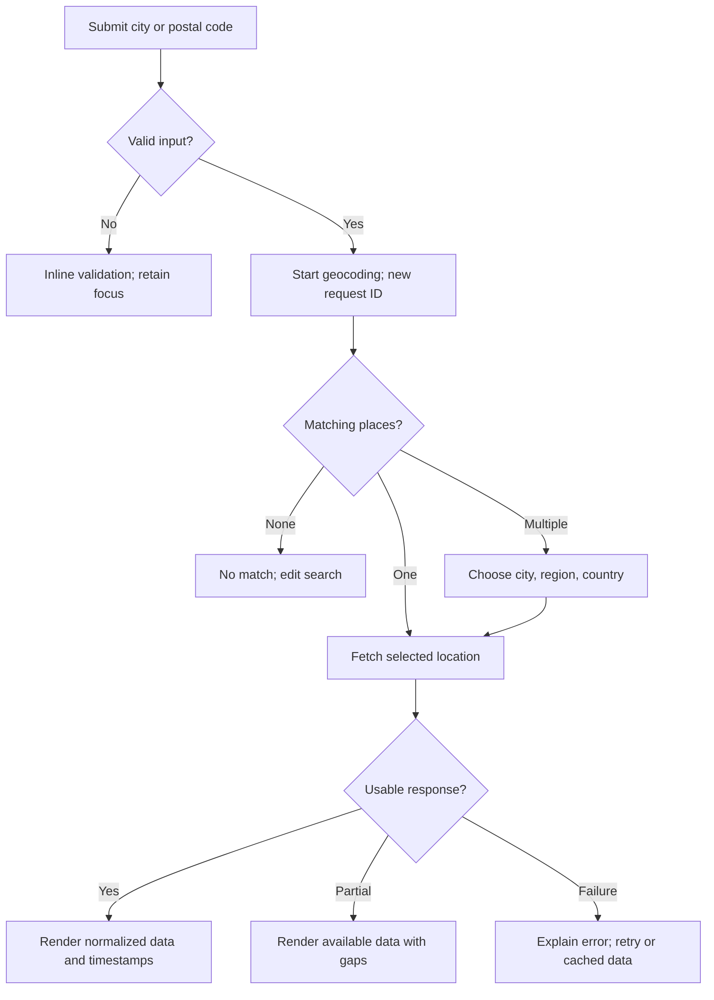

# SkyCast — Interaction flows

**Task 02 · No feature implementation**

## Main search and weather flow

Input validation occurs before network activity. Get Weather and Enter have the same behavior. While searching, retain query and selected unit; keep old weather under its old location with an Updating label rather than relabeling it with the new city. Weather selection commits the new location and its matching data coherently. If one geocoding candidate is returned, show its resolved full label; never hide a different country behind the query text.

Ambiguous candidate popup: Up/Down navigate, Enter chooses, Escape cancels and returns focus to search. New typing invalidates old candidates; late responses are discarded by request ID. Choosing a place starts weather loading. A failed geocoding or weather request clears only its own loading state and exposes safe retry/edit controls.

## Forecast navigation and selection

| Action | State change | Display effect | Network |
|---|---|---|---|
| Select Today | Tab Today; date = location-local today | Selected card current; H is next six future hours; current statistics | Reuse bundle |
| Select Tomorrow | Tab Tomorrow; date = today +1 | Daily high/low; future-date six-hour window; hourly-basis stats | Reuse bundle |
| Select Next 7 Days | Tab seven-day; retain valid selected date, else today | All seven dates; selected day details | Reuse bundle |
| Select a different day card | Set date; tab seven-day unless Today/Tomorrow explicitly chosen | Move expanded blue state to chronological slot; update H/D/G | Reuse bundle |
| Select an hourly cell | Set detail cursor | Future-date metric caption/values reflect that instant | None |
| Move future six-hour window | Set window start to next/previous six actual instants within date | H and rain D update together; cursor becomes first available slot | None |
| Reach local midnight | Recompute local today and visible days using clock | Date labels/availability refresh; preserve explicit future selection if valid | Refresh only under request policy |

Do not reorder the selected date to the left edge: the first blue card in the reference happens to be the selected day. Expand the selected chronological slot and bring it into view. Selection and keyboard focus are distinct. Current time is never displayed as a future forecast valid time.

## Unit change

Changing °C/°F sets one preference in the controller and rebuilds view models from Celsius data. All temperature cards, secondary cities, feels-like values, chart axes and future spoken summaries update together. High/low labels and source timestamps remain. Do not refetch weather, modify canonical values or repeatedly convert rounded numbers. If speech is playing, stop it and show “Units changed; press Listen to hear the updated summary.” Do not silently speak mixed units.

## Error and degraded-data recovery

| Failure | Message direction | Recovery / preserved state |
|---|---|---|
| Empty search | Enter a city or postal code | Focus search; no request |
| Unknown/unsupported location | No matching supported place; add a country or use a nearby city | Retain query and existing location |
| Timeout/offline | Weather could not be retrieved; connection may be unavailable | Retry; previous data remain clearly dated; Phase 2 may offer cache |
| Provider unavailable | Weather service temporarily unavailable | Bounded retry/retry-later; no infinite spinner |
| Rate limit | Too many requests; retry after indicated time | Disable repeated retries until allowed; no busy loop |
| Credential error in future adapter | Provider credentials need attention | Safe settings/help path; never reveal secret |
| Missing measurement | Unavailable for this period | Other valid data remain; no zero substitution |
| Incomplete six-hour/day coverage | Some forecast intervals unavailable | Explicit empty slots/date gaps; no invented values |
| Icon failure | Weather text remains; neutral placeholder | Optional retry independent of weather request |
| One secondary city fails | That city's current data unavailable | Local Retry, other cards unaffected |
| Map asset fails | Map unavailable; show location coordinates/name list | Retain region and search, not an unrelated panel |

Fresh downloads show source valid time and retrieval time. Phase 2 cache hits always say Cached, even inside the freshness window. Older cache says Stale, age, exact retrieval time and Refresh; do not describe it as current live weather. Old forecast intervals are removed from the future panel. Cached city A must never appear as city B after a failed new search.

## Phase 2 hooks

| Enhancement | Entry point and flow | Error/exit behavior |
|---|---|---|
| EN-01 Voice | Detail action Listen to Weather → Speaking + Stop → Ready; selected future day action explicitly says current weather | No autoplay; stop on location/unit changes; engine failure leaves visual weather usable |
| EN-02 Favorites | Star adds/removes current resolved place; favorites menu lists places → select → normal weather flow | Explain save failure; do not show successful star until persistence succeeds |
| EN-03 Metrics | Row G gains feels-like and probability tiles | Unavailable values stay unavailable; period caption mandatory |
| EN-04 Trend | Expand Temperature trend below H → real hourly chart → Collapse | Dispose chart on close; gaps remain visible |
| EN-05 Cache | Cache badge and Refresh in status; failed fetch offers matching cached bundle | Explicit age/source; manual search always remains available |
| EN-06 Sun events | Selected-day footer shows Sunrise/Sunset in local time | Missing/polar event says Unavailable, never midnight as placeholder |
| EN-07 Approximate location | Search utility → consent → provider lookup → confirm/edit approximate location → normal weather request | Cancel performs no lookup; failure returns to manual search; never runs at startup |

Consent wording: “Find an approximate location using your public IP? The location provider will receive your public IP address. Results may be inaccurate, especially on mobile networks or VPNs. You can choose a city instead.” Buttons: Find approximate location / Cancel. Confirm the detected place before using it. No microphone prompt belongs here.

## Twenty required states

| # | State | Required visible result |
|---|---|---|
| 1 | First launch | SkyCast shell, search invitation, no fictional weather |
| 2 | No location | Empty forecast areas with descriptive placeholders; basemap may appear without pins |
| 3 | Searching | Search progress, editable/cancelable flow, request generation |
| 4 | Multiple matches | Candidate popup with geographic disambiguation |
| 5 | Weather loading | Labeled loading while previous-city data retain identity |
| 6 | Successful retrieval | Coherent new city/bundle, source and time labels |
| 7 | Today | Current selected card, next six hours |
| 8 | Tomorrow | Future-day summary and labeled hourly window |
| 9 | Seven-day | Today through +6, interactive dates |
| 10 | Selected card | Blue expansion in chronological position; selection marker |
| 11 | Unit switch | Consistent temperature conversion everywhere |
| 12 | Network timeout | Inline safe error, Retry, no stuck loader |
| 13 | Invalid location | Search correction; no unrelated auto-selection |
| 14 | Provider down | Retained dated results or empty state, retry-later |
| 15 | Partial weather | Explicit gaps and unavailable metrics |
| 16 | Cache | Cached/stale age and Refresh |
| 17 | Empty cities | Add/select suggested city affordance, no fake card values |
| 18 | Missing icon | Condition text and neutral placeholder |
| 19 | Voice playing/stopped | Visible Stop/Listen state, no overlapping speech |
| 20 | Resize | Scroll/reflow with retained focus, unit, location and date |

## Map, dialogs and lifecycle

Pin selection sets the main location through the controller; it does not modify weather values directly. View wide displays a map-only dialog from existing data. Escape and Close return focus to the invoking control. About opens license/source information, not an account screen. Optional controls remain absent before their feature exists.

Every worker result is tagged by the initiating request generation and scope. Only matching results reach the Tk event loop. On window closure, polling/redraw callbacks stop, resources are disposed, speech is stopped and pending results are ignored. Repeated searches update reusable controls rather than appending duplicate cards.
