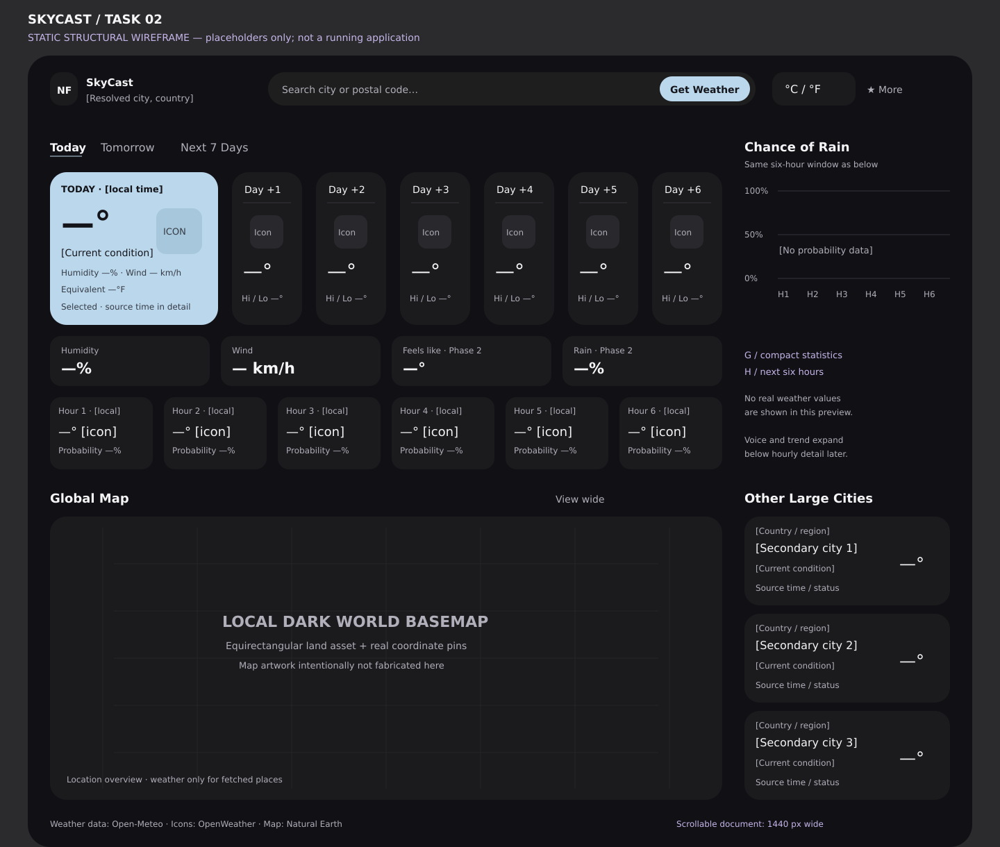

# SkyCast — Structural layout wireframe

**Task 02 · Static design artifact; no executable application**

[Open editable vector wireframe](UI_LAYOUT_PREVIEW.svg)

The wireframe uses the approved image's dominant relationships: compact top bar, horizontal forecast row with a wide blue selected card, narrow right rain panel, large lower-left map and lower-right city stack. The added row of statistics and next-six-hour strip increase scrollable height, rather than replace the map. This is a structural preview with placeholders, not simulated live weather or a production mockup. Its map grid reserves the exact asset area; it is not fabricated geographic artwork.

## Coordinate convention

UI_DESIGN_SPEC.md defines a 1440-wide client layout. The preview adds an 80 px explanatory title band; subtract 80 from preview y coordinates to get the design document coordinates. Horizontal coordinates are unchanged. PNG dimensions are 1440 × 1220. The actual app default is a 1440 × 900 viewport when the work area permits, viewing a taller scrollable document. No title-band text is intended as application content.

| Region | Design rectangle x,y,w,h | Contents / component |
|---|---|---|
| A | 72,24,1296,48 | TopNavigation: identity/location, search + Get Weather, units, optional utilities |
| B | 72,112,968,40 | ForecastTabs |
| C | 72,168,968,220 | SelectedDayCard 242 wide; six DailyForecastCard elements 101 wide, 20 gaps |
| D | 1072,112,296,276 | ChanceOfRainChart; no bars until data is available |
| G | 72,404,968,72 | Four WeatherStatCard tiles 230 wide, 16 gaps; full Phase 2 arrangement shown |
| H | 72,492,968,104 | Six HourlyForecastStrip cells 148 wide, 16 gaps |
| Lower labels | 72 / 1072,620 | Map/cities section headings |
| E | 72,664,968,408 | GlobalWeatherMap; large landscape panel retained |
| F | 1072,664,296,408 | Three OtherCityCard elements, 128 high, 12 gaps |
| Status | 72,1088,1296,40 | Attribution and timestamp/cache controls |

## Grid constraints, not absolute widgets

One centered shell contains a fixed header and a vertically scrollable body. The body uses two columns with weights approximating the source's 3.3:1 ratio. Cards and hourly rows manage horizontal overflow. G and H belong to the left column; lower E and F begin together after the left detail content. Consequently optional trend expansion or 2 × 2 metrics reflow shifts both lower panels equally.

At default width, source proportions are preserved within the larger scale: selected card 242 vs small card 101, main map width 968 vs city width 296. Source map width/height was about 2.38:1; proposed panel 968/408 is 2.37:1. The internal 2:1 equirectangular basemap is letterboxed so geographic projection stays accurate.

The selected card need not always be leftmost: its illustrated leftmost position is Today. Selecting another day expands its existing chronological slot, preserving order. The six-hour strip is separate and cannot be mistaken for the daily cards.

## Phase and size variants

| Variant | Visible differences |
|---|---|
| Phase 1 Today | Current blue card, seven daily dates, rain chart, humidity/wind tiles, six upcoming hours, local map and fetched cities |
| Phase 2 Today | Four metric tiles, favorites/IP utilities, voice action, collapsed expandable trend, cache and sunrise/sunset details |
| Tomorrow | Forecast blue card, six-hour window for next local date; supporting metrics labeled by selected hour |
| Seven-day | Date selection drives expanded card, hourly window and rain panel; current status remains separate |
| 1366-class laptop | Narrower two-column grid; horizontal card scrolling and vertical page scrolling; map height is retained |
| 1024 × 700 client | Search on second header row; 2 × 2 stats as needed; horizontal strips; vertical page; no clipped essentials |
| High-DPI constrained work area | Clamp initial size; use documented narrow/single-column fallback if logical work area is below minimum |

## Meaningful differences from source image

The preview deliberately avoids the screenshot's example readings, false geographic examples and qualitative rain-axis words. It assigns Get Weather and unit controls real roles; does not introduce air quality, accounts, a light theme or notifications. The map marketing overlay is omitted because it obscures location information and has no approved behavior. These are functional corrections within the selected composition, not a substitute UI concept.

The final typography, licensed illustrations and world land artwork must be evaluated in Task 04 Windows captures. This preview does not prove pixel-perfect parity or native rendering behavior.
